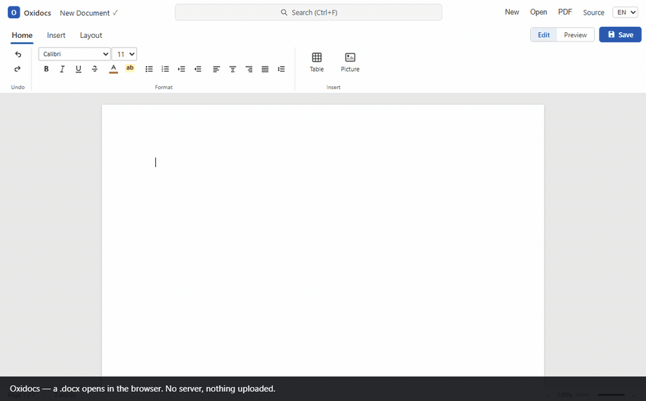
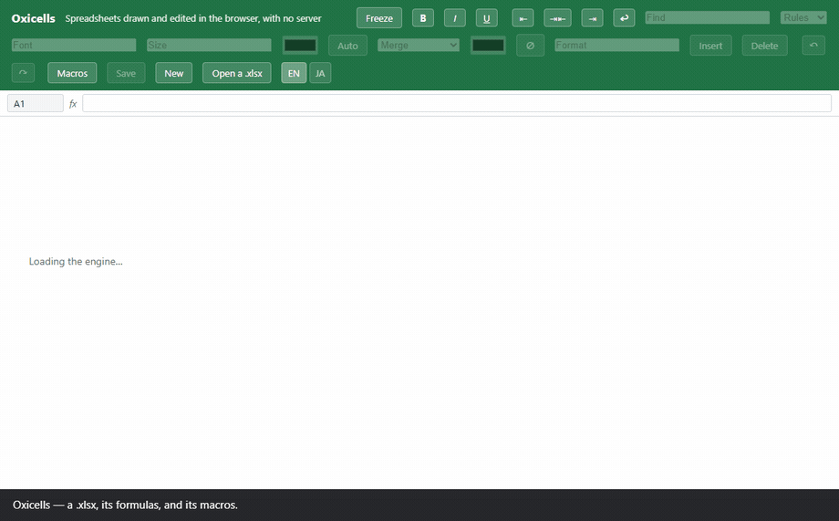
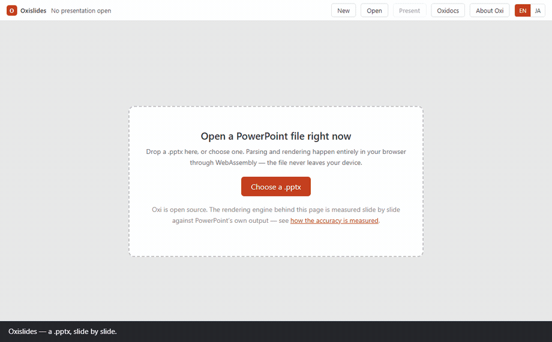
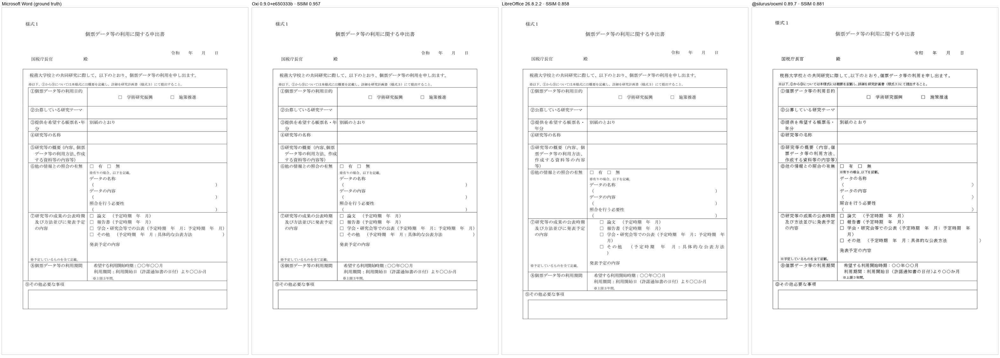

# Oxi

**Oxi = Opensource Xplatform Interoperability**

**Office documents, processed on your device.**

Oxi is an open-source engine for viewing and editing Word, Excel and PowerPoint files. Built in Rust and WebAssembly, it brings document processing into a browser, a desktop app or your own application, without a document-processing server or a Microsoft Office installation.

The goal is to keep existing documents and workflows usable across platforms: page layout, Japanese typography, spreadsheet formulas and supported VBA. Compatibility is measured against Microsoft Office itself.

[Word demo](https://ryujiyasu.gitlab.io/oxi/docs.html) · [Excel preview](https://ryujiyasu.gitlab.io/oxi/sheets.html) · [PowerPoint preview](https://ryujiyasu.gitlab.io/oxi/slides.html) · [Benchmarks](#layout-accuracy-vs-microsoft-word) · [Get started](#quick-start) · [Contribute](#contributing)

   

> **Canonical repository:** [GitHub — Ryujiyasu/oxi](https://github.com/Ryujiyasu/oxi) (issues, pull requests, CI, releases).
> The [GitLab repository](https://gitlab.com/Ryujiyasu/oxi) receives `main` from GitHub and exists to run the Pages job that serves the live demo.

## What Oxi Does

| Format | Capabilities |
|--------|--------------|
| **Word — `.docx`** | Paginated rendering, editing and PDF export, with Japanese typography as a primary target |
| **Excel — `.xlsx` / `.xlsm`** | Spreadsheet rendering, formulas, editing and a browser VBA host for supported workbook operations |
| **PowerPoint — `.pptx`** | Slide rendering and editing, measured against PowerPoint's own output |
| **PDF** | Parsing, text extraction, generation and digital-signature support |

The same Rust engines power the browser editors, desktop app, CLI and language bindings. Available features depend on the build; the full browser suite is built with `--features suite`. Full Microsoft Office and VBA compatibility remains in progress.

---

## What It Looks Like

Three editors over one engine, recorded from the assembled desktop build — the same files the installer ships. Nothing is staged: each clip opens a real file and the numbers on screen are the engine's own.

**Oxidocs — .docx**



**Oxicells — .xlsx**



**Oxislides — .pptx**



---

## Why Now

An Office file can open successfully and still move a page break, shift a table or change a calculation. Those differences make existing documents expensive to move between products, and make a document viewer difficult to embed in another application.

Oxi puts parsing, rendering, editing and supported spreadsheet execution into a reusable local engine. Its priorities are concrete: keep document processing on the user's device, make Japanese layout a first-class target, and measure compatibility against Word, Excel and PowerPoint.

---

## Layout Accuracy vs Microsoft Word

The published benchmarks compare Oxi with Microsoft Office's own output on fixed document sets.

| Reference and corpus | Mean visual similarity (SSIM) | Matching page / slide counts | Measurement |
|----------------------|-------------------------------|-----------------------------|-------------|
| **Word — English, 50 documents** | **0.903** | **47 / 50** | 2026-10-28, without Word's saved page-break hints |
| **Word — Japanese, 50 documents** | **0.905** | **47 / 50** | 2026-10-28, without Word's saved page-break hints |
| **PowerPoint — 48 usable decks from 50 sampled files** | **0.953** | **48 / 48** | 2026-08-20 |

SSIM measures visual similarity on these corpora. Formula and VBA behavior are checked separately against Excel. Coverage is limited to the measured documents and behaviors.

<details>
<summary>Full comparison tables, corpus definitions, limitations and reproduction</summary>

### How the corpora are split

An accuracy number is only as honest as the corpus it comes from. Oxi's documents are split into three roles, per language, and only one of them is allowed to be a headline:

| Role | What it is | May be a fix target? |
|------|------------|----------------------|
| **dev** | The tuned corpus: 96 documents under per-paragraph pagination gates + a 369-document (1113-page) pixel-SSIM sentinel + synthetic probes, plus every blind set retired by rotation | Yes — this is where bugs are root-caused |
| **validation** | Previously blind sets, demoted after rotation | Yes, after demotion |
| **blind** | 50 documents per language, **frozen before measurement, never anatomized**; re-measured per binary revision, not tuned against | **No** |

The blind sets are drawn from the public [superdoc-dev/docx-corpus](https://docxcorp.us/) (ODC-BY, 736K real .docx from Common Crawl) by a deterministic rule declared *before* fetching: 10 document types × the next 5 documents in SHA-256-ascending manifest order, with a purely mechanical quarantine (valid zip, has `word/document.xml`, no macros, ≤ 4 MB). No quality-based selection, no post-hoc swaps. When a newer blind set is frozen, the old one is demoted to validation and only then becomes fixable.

Everything below is measured against **Microsoft Word's own render** of the same file (Microsoft 365 16.0.20430.20182, 150 DPI, resize-to-match, structural similarity; one fresh Word process per document). Nobody grades their own homework.

One measurement note, because it would otherwise flatter a competitor: **OfficeCLI is measured with `--render html`, its own layout engine.** Its default `--render auto` is documented as "native on Windows w/ Word", and on a host with Word installed that path hands the rendering to Word itself — 0.996 SSIM against Word, because it *is* Word. Its own engine scores 0.972 on that same page. Only the second is a comparison.

### English blind set — blind-I50, 50 never-seen documents

Frozen 2026-10-25 (`pipeline_data/FROZEN_BLIND_I.md`) as the next unclaimed SHA-256 ranks per type, **before** any measurement. Every engine renders the same 50 documents; where one produced nothing for a document, its row says how many it managed. Word opened and exported all 100 documents of the two sets, so no quarantine replacement was needed this time.

**Why a new set.** Blind-H (2026-10-02) was spent the day its numbers were written down and has since been a fix target, so it can no longer say how the engine generalizes. The sets are different documents and are not comparable: Oxi scored 0.874 on H50 and 0.903 here.

**Every engine is at its latest public release on the measurement day** (2026-10-25): LibreOffice and ONLYOFFICE installed fresh, the npm-distributed engines at `@latest`, GenOffice pulled to its newest commit, and two engines that appeared since the last rotation added — [WordCraft](https://github.com/storytold/wordcraft) and [ibisOffice](https://github.com/ibisjp/ibis-office), both exporting a PDF from their own command line.

| Engine | mean SSIM (common pages) | penalized | page count matches Word | documents scored |
|--------|--------------------------|-----------|-------------------------|------------------|
| ONLYOFFICE 10.0.0 | **0.909** | **0.888** | 42 / 50 | 49 |
| **Oxi 0.8.9** | 0.903 | 0.883 | **47 / 50** | 50 |
| WordCraft 0.10.0 | 0.885 | 0.857 | 41 / 50 | 50 |
| LibreOffice 26.8.1.1 | 0.864 | 0.828 | 39 / 50 | 50 |
| SILURUS @silurus/ooxml 0.89.4 | 0.842 | 0.806 | 41 / 50 | 50 |
| Polaris Office 11.115 | 0.830 | 0.813 | 35 / 50 | 44 |
| GenOffice 28cee5ca | 0.815 | 0.747 | 35 / 50 | 49 |
| ibisOffice 0.8.4 | 0.783 | 0.706 | 33 / 50 | 50 |
| OfficeCLI 1.0.158 (`--render html`) | 0.770 | 0.443 | 14 / 50 | 50 |
| BetterOffice @betteroffice/docx 0.4.3 | 0.767 | 0.636 | 26 / 50 | 50 |
| eigenpal @eigenpal/docx-editor-react 1.9.0 | 0.756 | 0.704 | 33 / 50 | 50 |

**Oxi is second in English, 0.006 behind ONLYOFFICE — inside the ±0.02 one sample carries — and places page breaks best (47 / 50).** The mean hides a split worth stating: document by document, ONLYOFFICE is closer to Word on 37 of 50 and WordCraft on 34 of 50, while Oxi beats LibreOffice on 30 of 50. Oxi's mean holds up because its bad documents are less bad, not because it wins the typical one. The worst Oxi document is at 0.542 — a defect, since ONLYOFFICE scores it 0.924.

### Japanese blind set — jaBlindI50, 50 never-seen documents

Frozen 2026-10-25 by the same rule, **before** any measurement. The Japanese `technical` type is exhausted in the public manifest, so its five slots were filled by the pre-declared top-up rule (the next unclaimed entries across the other types in SHA order — all five came from `forms`).

| Engine | mean SSIM (common pages) | penalized | page count matches Word | documents scored |
|--------|--------------------------|-----------|-------------------------|------------------|
| **Oxi 0.8.9** | **0.905** | **0.899** | **47 / 50** | 50 |
| Polaris Office 11.115 | 0.848 | 0.826 | 46 / 50 | 50 |
| LibreOffice 26.8.1.1 | 0.831 | 0.789 | 41 / 50 | 50 |
| WordCraft 0.10.0 | 0.827 | 0.749 | 37 / 50 | 50 |
| GenOffice 28cee5ca | 0.825 | 0.737 | 34 / 50 | 50 |
| SILURUS @silurus/ooxml 0.89.4 | 0.821 | 0.719 | 31 / 50 | 48 |
| ibisOffice 0.8.4 | 0.819 | 0.776 | 41 / 50 | 50 |
| OfficeCLI 1.0.158 (`--render html`) | 0.810 | 0.629 | 32 / 50 | 50 |
| ONLYOFFICE 10.0.0 | 0.790 | 0.734 | 38 / 50 | 50 |
| BetterOffice @betteroffice/docx 0.4.3 | 0.785 | 0.675 | 34 / 50 | 50 |
| eigenpal @eigenpal/docx-editor-react 1.9.0 | 0.768 | 0.694 | 36 / 50 | 50 |

**Oxi is first in Japanese by 0.057 over Polaris Office and 0.074 over LibreOffice**, closer to Word than Polaris Office on 40 of 50 documents, than LibreOffice on 43, than WordCraft on 43 and than ONLYOFFICE on 48. Polaris Office comes within one document of Oxi on Japanese page breaks (46 / 50 against 47). The worst document (0.670) is hard for every engine — the others score it between 0.58 and 0.71, BetterOffice the one engine above Oxi on it.

**Rankings do not transfer between languages.** ONLYOFFICE is first in English and ninth in Japanese; Oxi is second in English and first in Japanese. That is the whole reason for keeping a blind set per language, and for keeping both numbers on this page rather than the flattering one.

Every engine was measured against the same Word ground truth (Microsoft 365 16.0.20430.20182, 150 DPI). Versions are recorded in `_engine_versions_blindI50.json` beside each result. Three measurement notes, each written down before any number was compared: (1) GenOffice's newest build hands its renderer the file as a one-shot URL instead of bytes; the harness first fed it bytes, every document opened as a blank page, and that run was discarded and redone — the numbers above are the redone run. (2) OfficeCLI's low page-count match is its own pagination: the harness takes the page count from OfficeCLI's own view and captures every page it reports. (3) Polaris Office has no command line, so its export is driven through its own window; the first run timed out on every document (the save dialog had moved and a leftover window took the next document's keystrokes), the driver was fixed before any Polaris number was read, and the six English documents Polaris still would not export on two attempts are counted as not rendered.

### How much does one blind set decide?

Three independently frozen Japanese blind sets, each measured once against the binary of its day:

| Japanese blind set | Oxi mean SSIM | page count matches Word |
|--------------------|---------------|-------------------------|
| blind-B50 (ranks 11-15, 2026-08-31) | 0.842 | 45 / 50 |
| blind-C50 (ranks 16-20, 2026-08-31) | 0.802 | 35 / 50 |
| blind-D50 (ranks 21-25, 2026-09-11) | 0.802 | 40 / 50 |
| blind-H50 (next unclaimed ranks, 2026-10-02) | 0.857 | 41 / 50 |
| blind-I50 (next unclaimed ranks, 2026-10-25) | 0.905 | 47 / 50 |

B50 and C50 were measured the same day on the same binary, so the 0.040 between them is set difficulty and nothing else. Roughly a quarter of that is a known defect — 19 of the 50 blind-C documents contain an anchored floating text box whose text Oxi drops, and those documents average 0.06-0.10 lower than the rest — and the remainder is simply that one sample of fifty wild documents is harder than another. **A single blind number carries about ±0.02, and a page-count rate can move 90% → 70% between samples.**

D50, cut eleven days and one engine revision later, landed on 0.802 again. Two independent samples agreeing to four decimal places is the strongest evidence on this page that the Japanese number is a property of the engine rather than of the corpus.

H50, three weeks and one engine generation later, is the first Japanese set to leave 0.80: 0.857. Two rotations (E, F, G) of pagination-only blind measurement were tuned against in between, so that step is engine, not sampling — but it is one sample, and the ±0.02 above still applies to it.

I50, three weeks and 219 commits later (145 of them layout fixes derived from Word measurements), is the first to pass 0.90: 0.905, with page breaks matching Word on 47 of 50. Again one sample, and the ±0.02 above applies.

The English sets moved too — 0.903 on C50, 0.837 on D50, 0.874 on H50, 0.903 on I50 — but C50 had been rotated into the development corpus by then, so set difficulty and tuning cannot be separated there and the C50 English number is retired rather than quoted.

Two honest caveats about the two engine tables together: (1) the English and Japanese sets are different documents, so the numbers are not comparable across languages — each is only comparable *within* its table; (2) engine rankings do not transfer between corpora (ONLYOFFICE leads English and comes ninth in Japanese), which is exactly why blind sets per language exist.



*What the differences look like: the same Japanese government research-application form (rotated table-cell labels), rendered by Word, Oxi, LibreOffice and @silurus/ooxml. This document is from the **development** corpus and is shown for illustration only — the numbers above come from the blind sets.*

### PowerPoint (PPTX) blind set — 50 HuggingFace documents

The same measurement discipline, applied to real-world `.pptx` files. 50 files are sampled at random (seed `20260809`) from [noxneural/pptx_collection_templates](https://huggingface.co/datasets/noxneural/pptx_collection_templates) before any measurement, and each is scored against **Microsoft PowerPoint's own render** (Microsoft 365 16.0.20131.20154, 150 DPI, resize-to-match, structural similarity — the same pipeline as the Word tables above).

| Engine | mean SSIM vs PowerPoint (per doc) | page count matches PowerPoint |
|--------|----------------------------------|------------------------------|
| **Oxi** (2026-08-20, re-measured) | **0.953** | **48 / 48** |
| LibreOffice 26.2.1.2 | 0.913 | 48 / 48 |
| ONLYOFFICE 9.3.1.8 | 0.908 | 48 / 48 |

Two of the 50 sampled files (corrupt zip containers, unopenable by every engine — PowerPoint COM, LibreOffice, ONLYOFFICE's x2t and Oxi all reject them) are excluded, leaving **48** measured documents — every engine matches PowerPoint's slide count on all 48. **Oxi now leads both suites on this frozen set** (paired difference vs LibreOffice +0.040 ± 0.005, |t| = 8.7, ahead on 44 of the 48 documents; LibreOffice and ONLYOFFICE remain statistically tied with each other). The set was first measured at **0.679** (2026-08-13, the renderer's first PPTX measurement) — the week of renderer work since (slide-master placeholder inheritance, group transforms under mirroring, embedded fonts, color emoji, mixed-face line boxes) moved it to 0.953, with **every one of the 48 documents improving and none regressing**; the worst document now scores 0.880. As with the Word tables, the set is frozen, never anatomized, and re-measured as the engine improves. One operational note: ONLYOFFICE's x2t emits unusually large intermediate PDFs (up to 65 MB for a single deck), which dominates its pipeline cost. Per-document scores, the paired statistics and the full method: [docs/benchmarks/pptx-hf50.md](docs/benchmarks/pptx-hf50.md); raw scores as JSON: [docs/benchmarks/pptx-hf50-results.json](docs/benchmarks/pptx-hf50-results.json).

### The internal gates (development corpus)

The blind sets are the published claim; the development corpus is how regressions are caught before a change is committed. Every layout change must pass, in order:

- **Pagination oracle** — per-paragraph page match against real Word (COM-measured) on the 96-document development corpus (90 Japanese + 6 English government documents): currently **96/96 = 100%**.
- **SSIM regression sentinel** — 369 documents (1113 pages) pixel-compared against stored Word renders; a change that improves one document by regressing another has to justify the trade.
- **Adversarial probe harness** — 95 synthetic documents stressing under-tested layout paths, each gated against real Word ground truth.
- **Feature-injection perturbation harness** — individual OOXML features injected one at a time into a clean base document and pixel-verified against Word.
- **PPTX render gate** — 40 development decks (886 slides) pixel-compared against PowerPoint's own PDF render (mean SSIM 0.957), plus 156 synthetic probe decks byte-compared per change and a determinism check (same input twice → identical bytes). LibreOffice Impress and a browser OOXML viewer render the same decks as independent references, so a slide where they land closer to PowerPoint than Oxi does is a bug with a worked example.
- **Spreadsheet oracles** — the formula engine recalculates 285 real .xlsx workbooks and diffs against Excel's own cached results; the browser VBA host is checked against real Excel COM behavior.
- **Unit / integration suite** — `cargo test`.

These numbers are *tuned* — every document in them has been individually root-caused — so they belong in a gate, not in a headline. The date-by-date development history is in [docs/layout_accuracy.md](docs/layout_accuracy.md); the derivation log is [RESEARCH_LOG.md](RESEARCH_LOG.md).

### Word's saved page breaks — a hint the benchmark must not see

When Word saves a .docx it writes `<w:lastRenderedPageBreak/>` wherever its own render started a new page. That marker is part of the answer every number on this page is scored against, and **Oxi's parser reads it by default**: several layout rules use it as a hint. The blind-set numbers above were measured that way. Whether the other engines in the tables read the marker has not been checked, so the page-count column may favour Oxi.

From now on the benchmarks run **blind**: `OXI_IGNORE_LRPB=1` makes the parser drop the marker, so no layout rule can see it, and `tools/metrics/bench_env.py` sets it for benchmark scripts unless `OXI_BENCH_WITH_LRPB=1` asks for the hinted mode. **Re-measured blind (2026-10-28).** The published blind-I numbers were re-run with the frozen engine (77605bde) on copies of the same 100 documents with every `<w:lastRenderedPageBreak/>` removed, against the same Word PDFs:

| | with the marker (published) | blind |
|---|---|---|
| EN mean SSIM / penalized / page count | 0.9028 / 0.8829 / 47 of 50 | 0.9031 / 0.8831 / 47 of 50 |
| JA mean SSIM / penalized / page count | 0.9050 / 0.8985 / 47 of 50 | 0.9050 / 0.8985 / 47 of 50 |

The tables above stand: the marker did not contribute to them. The current engine also scores identically in both modes on blind-I. Benchmarks keep running blind by default regardless.

The same marker also makes a **Word-free pagination check** that anyone can run on their own files. `tools/oxi-lrpb-bench` derives the page every paragraph and table row starts on from the markers, checks that derivation against the page count Word wrote in `docProps/app.xml`, then scores Oxi blind and hinted:

```bash
cd tools/oxi-lrpb-bench && cargo build --release
./target/release/oxi-lrpb-bench <file.docx | folder>... [--json out.json]
```

First run, on the Word-saved files of [docling](https://github.com/docling-project/docling)'s public `tests/data/docx` (2026-10-28; English only, so a smoke test rather than a claim):

| | blind | hinted |
|---|---|---|
| paragraphs and table rows on Word's page | 286 / 304 | 286 / 304 |
| page count matches Word | 8 / 10 | 8 / 10 |
| Word's page breaks placed at the same spot | 16 / 17 | |

The derived page counts matched `docProps/app.xml` on all 10 files. The marker cannot replace Oxi: it gives a page number but no position on the page, files saved by anything other than Word do not carry it, and it goes stale as soon as the document is edited.

### Reproduce

```bash
tools/metrics/fetch_docx_corpus.py      # fetch the public corpus (deterministic, SHA-ordered)
tools/metrics/ssim_now.py               # Oxi absolute SSIM re-measure vs stored Word renders
tools/metrics/ssim_ab.py <VAR>          # A/B a single rule against the whole corpus
tools/metrics/render_libra.py           # LibreOffice headless → PDF → PNG
tools/metrics/render_onlyoffice.py      # ONLYOFFICE x2t headless → PDF → PNG
tools/metrics/browser_oracle.py         # @silurus/ooxml via Playwright (tools/browser-oracle/)
tools/metrics/compare_renderers_3way.py # cross-renderer scoring on identical inputs
tools/oxi-lrpb-bench                    # Word-free page-break check against Word's saved markers
```

</details>

---

## How the Fidelity Is Earned

### 100% Clean-Room Implementation

Oxi's rendering engine was built without any disassembly, decompilation, or binary analysis of proprietary software. All layout specifications come from two sources only:

1. **Published standards** — OOXML (ISO/IEC 29500 / ECMA-376), PDF (ISO 32000)
2. **Black-box testing** — observing output values via the Microsoft Office COM API, and measuring Word's own PDF/PNG renders

AI (Claude) was used throughout specification derivation — root-cause analysis, COM measurement, pattern confirmation, fix implementation — with every specification decision grounded in measured values and confirmed by human review. Under Microsoft's [Open Specification Promise](https://learn.microsoft.com/en-us/openspecs/dev_center/ms-devcentlp/1c24c7c8-28b0-4ce1-a47d-95fe1ff504bc), no patents are asserted against implementations of the OOXML specification.

### Dual Font Engine: GDI + DirectWrite

Word's layout is built on GDI, which rounds character widths to integer pixels and computes line heights by rounding ascent and descent separately before adding them. These roundings cascade: a 0.18pt/character difference at Calibri 11pt becomes 10.8pt of accumulated error over 60 characters — enough to change where lines break and pages split. Reproducing Word therefore requires reproducing GDI exactly; for formats without a GDI heritage, it requires *not* inheriting those constraints.

| Format | Engine | Reason |
|--------|--------|--------|
| .docx (Word compatible) | **GDI** | Word uses GDI text metrics — integer-pixel rounding, tmHeight line heights, hinting-dependent widths |
| .odt / .pdf | **DirectWrite** | ODF has no single canonical engine; DirectWrite's floating-point metrics give cross-platform consistency, variable-font and modern OpenType support, without GDI's legacy rounding |

Both engines implement a shared `FontEngine` trait, so the layout engine switches with a one-line configuration change per document.

### Open Fonts Only

Oxi bundles no proprietary fonts. Open-licensed fonts are metric-matched to their Microsoft counterparts (advance width, line height, kerning — verified by automated tests). For documents authored with Microsoft Fonts, a **font divergence score** — a per-glyph pixel-diff table generated once on a licensed system, combined with the document's character frequency — quantifies visual fidelity without shipping proprietary fonts at runtime.

### Golden Tests — 504 Files, 100% Parse Success

Tested against 504 real-world government documents (Japanese ministries) + generated files:

|        | Oxi    | LibreOffice |
|--------|--------|-------------|
| Overall | 100.0% | 99.2% |
| DOCX   | 100.0% | 100.0% |
| XLSX   | 100.0% | 98.6% |
| PPTX   | 100.0% | 100.0% |

LibreOffice timed out (>45s) on 4 large government xlsx files. Oxi parsed all instantly.

---

## First-Class Japanese Typography

Most Word-compatible renderers treat Japanese layout as an afterthought. For Oxi it is a measured target:

- **Kinsoku shori (禁則処理)** — JIS X 4051 line-breaking: prohibited line-start/line-end characters, punctuation compression, hanging punctuation (ぶら下げ)
- **Vertical writing (縦書き)** — vertical sections with right-to-left column flow, plus **tate-chu-yoko (縦中横)**
- **Ruby (ルビ / furigana)**, **warichu (割注)** two-line inline notes, **emphasis marks (圏点)**
- **Character grid (docGrid)** — Word's Japanese line-grid and character-pitch model
- **Hanko (判子)** — Japanese digital stamp generation (round, square, oval) with PAdES PDF signatures

---

## Where Oxi Fits

Oxi is intended for applications that need Office document handling on the user's device: embedded viewers and editors, document workflows, and desktop tools built on the same engine.

| Design choice | What it provides |
|---------------|------------------|
| **Local Rust / WebAssembly execution** | Document processing without a document-processing backend |
| **Format engines with shared utilities** | Dedicated document, spreadsheet and slide models, with common OOXML and WebAssembly infrastructure |
| **Microsoft Office as the reference** | Compatibility checked against external output and behavior |
| **Japanese typography as a measured target** | Dedicated work on line breaking, vertical text, ruby and document grids |
| **Open-source engines and language bindings** | Source access and an API for embedding; see the [license](#license) |

The dated benchmark tables above show comparisons with other renderers, including cases where Oxi falls behind. The current release still has layout, editing and VBA gaps.

---

## Also in the Box

Beyond .docx rendering (the core mission), Oxi also ships:

- **.xlsx / .pptx / PDF** — parsing, rendering, text extraction, PDF generation
- **Round-trip editing** — edit .docx / .xlsx / .pptx; the original ZIP is preserved and only changed XML text nodes are patched, never rebuilt from scratch (a no-edit save is byte-identical, and that is a test)
- **Spreadsheet formulas + browser VBA** — a dependency-graph formula engine checked against Excel's cached results across 285 real workbooks, and a client-side VBA host for supported workbook macros: Range / Worksheet / Workbook operations, Sort, AutoFilter, Find, Copy/PasteSpecial and WorksheetFunction. Macro edits write back through the differential patcher. API coverage and edge cases continue to expand; full Excel VBA compatibility is still in progress.
- **Rich formatting** — run/paragraph shading, character borders, text effects (shadow / emboss / imprint / outline), small caps, drop caps, tab leaders
- **Hanko / Inkan** — Japanese digital stamp generation + PAdES PDF signatures
- **Local document processing** — the browser engine handles documents on the device without a document-processing backend
- **VS Code extension** — open .docx / .xlsx / .pptx inside the editor, rendered by the same WebAssembly build ([editors/vscode](editors/vscode))

These reuse common OOXML utilities, font metrics and language bindings. The rendering benchmarks above provide the visual compatibility measurements.

---

## Architecture

```
crates/
  oxidocs-common/     Shared OOXML utilities (ZIP, XML, relationships)
  oxidocs-core/       .docx engine — parser, IR, layout, font metrics, editor
  oxicells-core/      .xlsx engine — parser, IR, editor
  oxicells-calc/      Spreadsheet formulas and recalculation
  oxivba-core/        VBA parser, compiler and runtime
  oxislides-core/     .pptx engine — parser, IR, editor
  oxipdf-core/        PDF 1.7 engine — parser, text extraction, generator
  oxihanko/           Japanese digital stamp (hanko) generator + PAdES signer
  oxidocs-wasm/       WebAssembly bindings (wasm-bindgen)
web/                  Web demo (vanilla JS + Canvas)
tools/
  font-metrics-gen/   Standalone tool to extract font metrics from system fonts
  font-glyph-diff-gen/ Per-glyph pixel-diff table for Microsoft Font divergence scoring
  metrics/            Measurement, comparison and SSIM scripts
  oxi-gdi-renderer/   Native GDI verification renderer
  oxi-dwrite-renderer/ Native DirectWrite verification renderer
tests/fixtures/       Test .docx / .xlsx / .pptx files
```

### IR Design

The document IR is language-agnostic and does not depend on Word-specific internals. Spreadsheets and presentations have their own models:

```
Document → Page → Block (Paragraph | Table | Image) → Run
```

### WASM API

All processing is exposed via wasm-bindgen and can be called directly from JavaScript:

```javascript
import init, {
  parse_document,        // .docx → IR (JSON)
  parse_spreadsheet,     // .xlsx → IR (JSON)
  parse_presentation,    // .pptx → IR (JSON)
  layout_document,       // .docx → positioned layout with coordinates
  edit_docx,             // apply text edits → new .docx bytes
  edit_xlsx,             // apply cell edits → new .xlsx bytes
  edit_pptx,             // apply slide edits → new .pptx bytes
  create_blank_docx,     // generate empty .docx
  parse_pdf,             // PDF → structure (JSON)
  pdf_extract_text,      // PDF → plain text
  create_pdf,            // generate PDF from scratch
  pdf_verify_signatures, // verify PDF signatures
  generate_hanko_svg,    // generate stamp SVG with custom config
  preview_hanko,         // quick stamp preview by name
} from "./oxidocs_wasm.js";

await init();
const bytes = new Uint8Array(await (await fetch("sample.docx")).arrayBuffer());
const layout = layout_document(bytes); // positioned elements for canvas rendering
```

---

## Quick Start

### Install it

```bash
npm install @oxidocs/wasm             # published Word-focused browser bindings
cargo install oxidocs-cli            # the command-line tool
```

Or download a desktop installer for Windows, macOS or Linux from
[Releases](https://github.com/Ryujiyasu/oxi/releases). Installed apps update
themselves from that feed.

The published npm package uses the default Word-focused build. To use the spreadsheet, presentation and VBA browser editors, build the full suite below.

The Rust engine crates include `oxidocs` (the facade), `oxidocs-core`, `oxicells-core`, `oxislides-core`, `oxipdf-core`,
`oxihanko`, `oxivba-core`.

### Build it yourself

**Prerequisites:**
Rust 1.93+ and wasm-pack 0.14+.

**Build and test:**

```bash
cargo build                          # Build all crates
cargo test                           # Run tests
cargo clippy                         # Lint
```

**Build the wasm and serve the demo:**

```bash
cd crates/oxidocs-wasm
wasm-pack build --target web --release -- --features suite
cp pkg/oxidocs_wasm* ../../web/       # Copy this build into the local demo

cd ../../web
python3 -m http.server 8080          # Serve at http://localhost:8080
# Word: /docs.html; Excel/VBA: /xlsx-demo.html; slides: /pptx-editor.html
```

---

## Tech Stack

| Layer | Technology |
|-------|------------|
| Core engines | Rust (memory-safe, zero-cost abstractions) |
| XML parsing | quick-xml |
| ZIP handling | zip crate |
| Serialization | serde / serde_json |
| Browser bindings | wasm-bindgen + wasm-pack |
| Font metrics | Pre-computed metric tables; generation tools in tools/font-metrics-gen |
| Web demo | Vanilla JS + Canvas (no framework dependencies) |

---

## Security & Hardening

Oxi treats document parsing, rendering and macro execution as separate parts of the security model. See [SECURITY.md](SECURITY.md) for the reporting policy and current limits.

- **Local parsing and layout** — document-processing code runs on the client; parsing and layout do not require network requests.
- **Browser isolation** — the browser build runs in WebAssembly. Optional native Windows font and renderer bindings are separate from the browser runtime.
- **VBA has its own runtime** — the spreadsheet host interprets supported VBA through Oxi's APIs. It does not run Microsoft Office or provide native Windows COM execution.
- **Streaming XML** — external entities and DTDs are not fetched or expanded.

---

## Roadmap

The version number is the **mean pixel similarity to Word on the current frozen blind
sets, with every page Oxi gets wrong counted against it**: `0.8.9` means that on the
never-seen English and Japanese benchmarks above, Oxi's documents average penalized SSIM
0.89 against Word's own render of the same files (0.883 and 0.899; a page Oxi adds or
drops scores zero; two-decimal truncation of the two-language mean). The number is
measured, not tuned — a blind set is spent once its number is written down and a new one
is frozen before the next release — and `1.0` is the project's stop condition rather than
its finish line. Per-release detail: [CHANGELOG.md](CHANGELOG.md).

- **0.8 — current:** Word-compatible .docx rendering; the measurement loop (dev gates + rotating blind benchmarks); .pptx and .xlsx rendering, formula engine and browser VBA host; PDF; round-trip editing; WASM + Canvas editor, CLI, desktop app, Python bindings
- **0.9 — the blind sets average 0.9 penalized:** win the typical English document, not just the mean (ONLYOFFICE is closer to Word on 37 of 50 blind-I documents, WordCraft on 34), lift the worst documents (nine English and six Japanese below 0.80 on blind-I), IME (Japanese/CJK input) and editor polish. The page-1 line census reached zero on 2026-10-25: across the hundred blind-G documents, no first-page line is more than 2pt from Word's
- **1.0 — indistinguishable from Word:** no document in the corpus below 1.0. This is the falsifiable claim the whole loop exists to serve; counterexamples are the contribution most wanted
- **Beyond 1.0 — format parity:** .odt rendering via DirectWrite, measured against a deterministic reference renderer with the same externally-gated loop; bidirectional .docx ↔ .odt at the IR level

The measurement loop (deterministic reference output, falsifiable hypotheses, external merge gate, blind holdout) transfers to ODF unchanged — only the reference renderer changes.

---

## Contributing

Contributions are welcome. Oxi has a simple acceptance criterion:

**Every merged PR must improve the pixel accuracy of at least one document — without regressing the gates.**

### What belongs in core
1. Pixel accuracy improvements to the existing layout engine
2. New test documents with low pixel accuracy (must use OpenFont, improvement tracked via Issue)
3. New OpenFont additions (Microsoft Font metric parity verification required)
4. Format engine additions: .xlsx layout, .pptx layout, vertical writing, etc.

### What belongs elsewhere
Features that go beyond pixel-accurate rendering — collaboration, AI integration, purpose-specific workflows — belong in a separate extension or downstream project, not in Oxi core.

The desktop app is not one of those: `oxi-desktop` is the same engine in a window rather than a tab, so it ships in core under the same license as the rest of it.

### How to contribute
1. Fork the repository
2. Create a feature branch (`git checkout -b feature/amazing-feature`)
3. Run tests and lint (`cargo test && cargo clippy`)
4. Sign off your commits (`git commit -s`) — Oxi uses the [Developer Certificate of Origin](https://developercertificate.org/) (DCO). No CLA, no copyright assignment: your code stays yours
5. Submit a pull request with pixel accuracy results

See [CONTRIBUTING.md](CONTRIBUTING.md) for details.

---

## Why Rust + Wasm?

- **Performance** — native-speed document parsing and layout in the browser
- **Memory safety** — no buffer overflows, no use-after-free, no data races
- **Builds for your use case** — Word-focused bindings or the full suite; an optional external font catalog loads metric data on demand
- **Static delivery** — the browser runtime can be served as static assets, with document processing on the client
- **Privacy** — document processing does not require uploading user files

---

## License

Oxi is licensed in three layers, chosen to maximize both adoption and the flow of improvements back into the canonical tree:

| Layer | License | Why |
|-------|---------|-----|
| **Core engine** (`oxidocs`, `oxidocs-common`, `oxidocs-core`, `oxicells-core`, `oxislides-core`, `oxipdf-core`, `oxihanko`, `oxidocs-cli`, `oxi-desktop`) | [MPL-2.0](LICENSE) | File-level copyleft: modifications to engine files must be published, so layout-fidelity improvements converge into one tree. Embedding Oxi in proprietary or commercial products is fully permitted — only changes to Oxi's own files must be shared. Same license as LibreOffice and Firefox |
| **Bindings** (`oxidocs-wasm`, `oxidocs-python`) | MIT OR Apache-2.0 | Standard Rust dual license — zero friction for embedding in any stack |
| **Conformance corpus** (self-authored repro documents under `tools/golden-test/repros/`) | CC BY-SA 4.0 | The Word-compatibility test suite is a shared public asset; improvements to it must stay shared |

Contributions are accepted under the [Developer Certificate of Origin](https://developercertificate.org/) (`git commit -s`). There is no CLA — contributors keep their copyright, and the project cannot relicense your work out from under you.

All third-party dependencies must be MPL-2.0-compatible (MIT, Apache-2.0, BSD, etc.).
