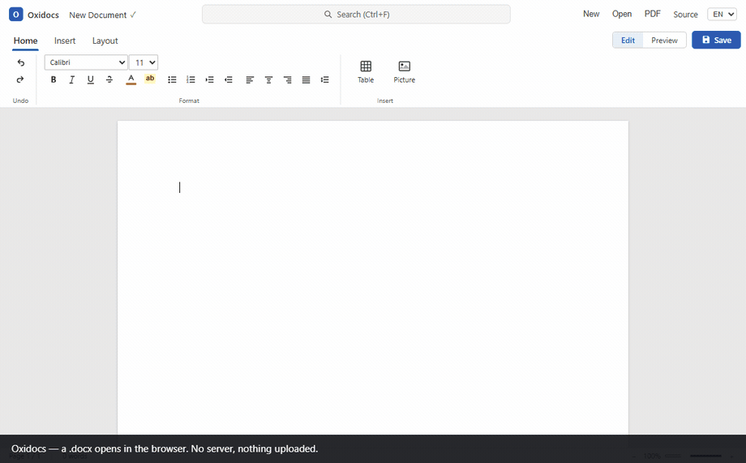
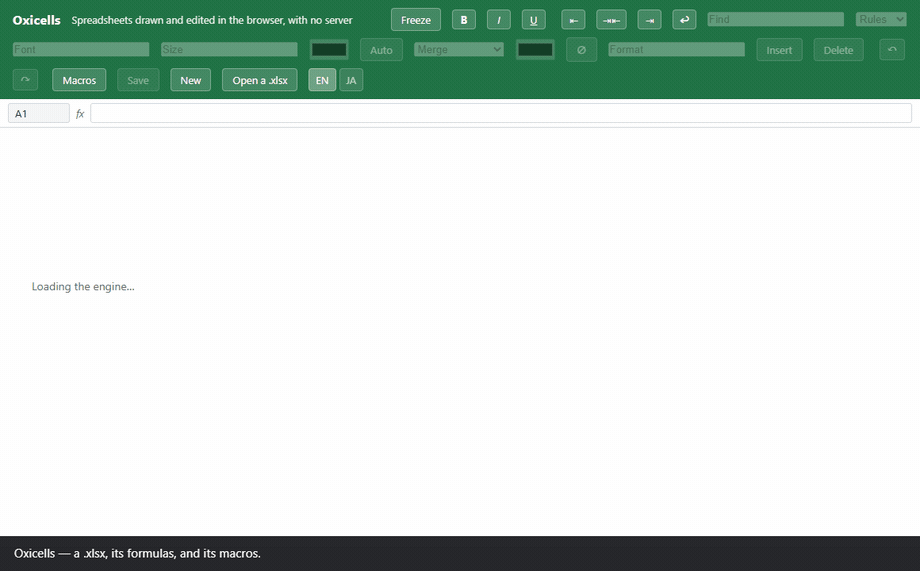
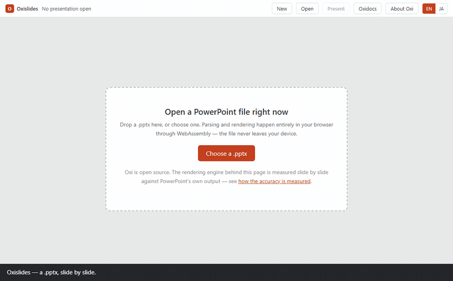
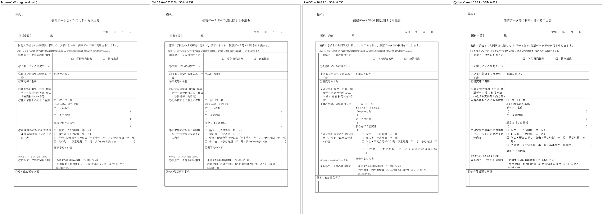

<p align="center">
  
</p>

<h1 align="center">Oxidocs</h1>

<p align="center">
  <b>Word, Excel and PowerPoint — opened, edited and turned into PDF on the device.</b><br>
  No Office, no document server, no upload. One Rust + WebAssembly engine,<br>
  measured page by page against Microsoft Office itself.
</p>

<p align="center">
  <a href="https://ryujiyasu.gitlab.io/oxi/docs.html"><b>Try it in the browser</b></a> ·
  <a href="#get-started-in-30-seconds">Get started</a> ·
  <a href="#layout-accuracy-vs-microsoft-word">Benchmarks</a> ·
  <a href="#contributing">Contribute</a>
</p>

<p align="center">
  <a href="https://pypi.org/project/oxidocs/"></a>
  <a href="https://www.npmjs.com/package/@oxidocs/wasm"></a>
  <a href="https://marketplace.visualstudio.com/items?itemName=oxidocs.oxi-office-viewer"></a>
  <a href="https://github.com/Ryujiyasu/oxi/releases"></a>
  <a href="LICENSE"></a>
</p>

*Oxidocs was called Oxi until November 2026.*

> **Canonical repository:** [GitHub — Ryujiyasu/oxi](https://github.com/Ryujiyasu/oxi) (issues, pull requests, CI, releases). The [GitLab mirror](https://gitlab.com/Ryujiyasu/oxi) runs the Pages job that serves the live demo.

---

<table>
<tr>
<td width="33%" align="center" valign="top"><br><b>Word</b> <code>.docx</code><br><sub>Laid out as Word does · edit · PDF</sub></td>
<td width="33%" align="center" valign="top"><br><b>Excel</b> <code>.xlsx</code> <code>.xlsm</code><br><sub>Formulas recalculated · VBA in the browser</sub></td>
<td width="33%" align="center" valign="top"><br><b>PowerPoint</b> <code>.pptx</code><br><sub>Drawn, edited and presented</sub></td>
</tr>
<tr>
<td valign="top"></td>
<td valign="top"></td>
<td valign="top"></td>
</tr>
</table>

Recorded from the desktop build — the same files the installer ships, nothing staged.

## Why Oxidocs

- **The document never leaves the device.** The engine runs in the browser tab, in your process or as one binary. There is no document server to deploy, secure or send files to.
- **It looks like Office, and that is measured.** Every release is scored against Microsoft Office's own render of documents the engine has never seen. Oxidocs is first among eleven engines in English and Japanese ([numbers below](#layout-accuracy-vs-microsoft-word)).
- **One engine, everywhere.** The same Rust code runs as WebAssembly in a page, as a Python package, as a CLI that stands in for LibreOffice, as a desktop app and inside VS Code.
- **Open source, embeddable.** The engine is MPL-2.0 and the bindings MIT / Apache-2.0: use it in commercial products; only changes to Oxidocs' own files are shared back.

<a id="quick-start"></a>

## Get started in 30 seconds

| You want to… | Do this |
|---|---|
| See it work | Open the [Word demo](https://ryujiyasu.gitlab.io/oxi/docs.html), [Excel](https://ryujiyasu.gitlab.io/oxi/sheets.html) or [PowerPoint](https://ryujiyasu.gitlab.io/oxi/slides.html) and drop a file in — it stays in your browser |
| Convert .docx to PDF from Python | `pip install oxidocs` |
| Render Word documents in your web app | `npm install @oxidocs/wasm` |
| Open Office files in VS Code next to your AI agent | `code --install-extension oxidocs.oxi-office-viewer` ([editors/vscode](editors/vscode)) |
| Replace `soffice --convert-to pdf` | `cargo install oxidocs-cli` ([below](#in-place-of-libreoffice)) |
| Use it as a desktop app | Installers for Windows, macOS and Linux on [Releases](https://github.com/Ryujiyasu/oxi/releases); they update themselves |

```javascript
import init, { layout_document } from "@oxidocs/wasm";

await init();
const bytes = new Uint8Array(await (await fetch("report.docx")).arrayBuffer());
const layout = layout_document(bytes); // every glyph, line and table cell, positioned like Word
```

## What people build with it

- **Document viewers and editors inside business apps**, without a conversion backend. The [integrations](integrations) for Nextcloud, Paperless, Cloudreve, Orca and Gotenberg are built this way.
- **AI agents that write Office files** — the VS Code extension redraws the file each time the agent saves it, so you see what Word would show.
- **Conversion pipelines** — a drop-in for LibreOffice's `--convert-to pdf`: the [Gotenberg module](integrations/gotenberg) converted 99.8% of 4,988 real documents itself, at a median 0.08 s against LibreOffice's 0.89 s.
- **Document data for search and RAG** — page, line and box positions without rendering a single pixel.

## What it handles

| Format | Capabilities |
|--------|--------------|
|  **Word — `.docx`** | View, edit and export PDF; Japanese typography; round-trip saves that patch only what changed |
|  **Excel — `.xlsx` / `.xlsm`** | View and edit, recalculate formulas, run supported VBA macros |
|  **PowerPoint — `.pptx`** | View, edit and present |
| **PDF** | Read and extract text, create PDFs, digital signatures |

Full Office and VBA compatibility is still in progress; the benchmarks below say exactly how far it goes.

## Layout accuracy vs Microsoft Word

Scored against **Microsoft Office's own render** of the same file (SSIM at 150 DPI), on sets of 50 real documents per language that were frozen **before** measurement and are never used to tune the engine.

**Latest (2026-11-20):** English **0.926** (page count matches Word on 49 / 50), Japanese **0.884** (43 / 50). Chinese **0.874** (48 / 50, 2026-11-09). PowerPoint **0.953** (48 / 48).

**Against other engines** on the same never-seen documents (blind-J50 / jaBlindJ50, 2026-11-03, every engine at its latest release that day):

| Engine | English | Japanese | Page count matches Word (EN / JA) |
|--------|---------|----------|-----------------------------------|
| **Oxidocs** | **0.924** | **0.892** | **46 / 45** |
| ONLYOFFICE 10.0 | 0.921 | 0.770 | 43 / 42 |
| LibreOffice 26.8 | 0.889 | 0.807 | 44 / 42 |
| Polaris Office 11.1 | 0.823 | 0.812 | 34 / 33 |
| ibisOffice 0.8.5 | 0.801 | 0.825 | 36 / 43 |

Six more engines were measured; Oxidocs is first in both languages. In English its lead over ONLYOFFICE (0.003) is within one sample's noise, and ONLYOFFICE is closer to Word on 30 of the 50 documents. In Chinese, Oxidocs leads WPS Office 0.874 to 0.836.



*The same Japanese government form rendered by Word, Oxidocs, LibreOffice and @silurus/ooxml (a development document, shown for illustration).*

**Full tables, corpus rules, limits and how to reproduce every number: [docs/BENCHMARKS.md](docs/BENCHMARKS.md).**

The engine was built clean-room — from the published OOXML and PDF standards and black-box measurement of Office's output, with no disassembly of proprietary software — and bundles only open-licensed fonts.

## First-class Japanese typography

Most Word-compatible renderers treat Japanese layout as an afterthought. For Oxidocs it is a measured target:

- **Kinsoku shori (禁則処理)** — JIS X 4051 line-breaking: prohibited line-start/line-end characters, punctuation compression, hanging punctuation (ぶら下げ)
- **Vertical writing (縦書き)** — vertical sections with right-to-left column flow, plus **tate-chu-yoko (縦中横)**
- **Ruby (ルビ / furigana)**, **warichu (割注)** two-line inline notes, **emphasis marks (圏点)**
- **Character grid (docGrid)** — Word's Japanese line-grid and character-pitch model
- **Hanko (判子)** — Japanese digital stamp generation (round, square, oval) with PAdES PDF signatures

## More in the box

- **.xlsx / .pptx / PDF** — parsing, rendering, text extraction, PDF generation
- **Round-trip editing** — edit .docx / .xlsx / .pptx; the original ZIP is preserved and only changed XML text nodes are patched, never rebuilt from scratch (a no-edit save is byte-identical, and that is a test)
- **Spreadsheet formulas + browser VBA** — a dependency-graph formula engine checked against Excel's cached results across 285 real workbooks, and a client-side VBA host for supported workbook macros: Range / Worksheet / Workbook operations, Sort, AutoFilter, Find, Copy/PasteSpecial and WorksheetFunction. Macro edits write back through the differential patcher. API coverage and edge cases continue to expand; full Excel VBA compatibility is still in progress.
- **Rich formatting** — run/paragraph shading, character borders, text effects (shadow / emboss / imprint / outline), small caps, drop caps, tab leaders
- **Hanko / Inkan** — Japanese digital stamp generation + PAdES PDF signatures
- **Gotenberg module** — converts .docx on Gotenberg's LibreOffice route with Oxidocs and hands anything it cannot fully serve back to LibreOffice; on 4,988 docx-corpus documents it converted 99.8% itself, at a median 0.08 s against LibreOffice's 0.89 s ([integrations/gotenberg](integrations/gotenberg))

## In place of LibreOffice

Programs that convert with `soffice --headless --convert-to pdf --outdir DIR FILE`
can run Oxidocs instead: link the binary as `soffice` (or call `oxidocs soffice …`)
and point them at it. It takes that command line for .docx, .pptx and .xlsx to
PDF, or to PNG of the first page, writing `DIR/<name>.pdf` as LibreOffice does.
Any other file, target or option goes to the LibreOffice named by
`OXIDOCS_SOFFICE_FALLBACK`, or fails if none is set.

```bash
ln -s "$(command -v oxidocs)" /usr/local/bin/soffice
soffice --headless --convert-to pdf --outdir out report.docx deck.pptx book.xlsx
```

The published npm package uses the default Word-focused build. To use the spreadsheet, presentation and VBA browser editors, build the full suite below.

The Rust engine crates include `oxidocs` (the facade), `oxidocs-core`, `oxicells-core`, `oxislides-core`, `oxipdf-core`,
`oxihanko`, `oxivba-core`.

## Architecture

```
crates/
  oxidocs-common/     Shared OOXML utilities (ZIP, XML, relationships)
  oxidocs-core/       .docx engine — parser, IR, layout, font metrics, editor
  oxicells-core/      .xlsx engine — parser, IR, editor
  oxicells-calc/      Spreadsheet formulas and recalculation
  oxivba-core/        VBA parser, compiler and runtime
  oxislides-core/     .pptx engine — parser, IR, editor
  oxipdf-core/        PDF 1.7 engine — parser, text extraction, generator
  oxihanko/           Japanese digital stamp (hanko) generator + PAdES signer
  oxidocs-wasm/       WebAssembly bindings (wasm-bindgen)
web/                  Web demo (vanilla JS + Canvas)
tools/
  font-metrics-gen/   Standalone tool to extract font metrics from system fonts
  font-glyph-diff-gen/ Per-glyph pixel-diff table for Microsoft Font divergence scoring
  metrics/            Measurement, comparison and SSIM scripts
  oxi-gdi-renderer/   Native GDI verification renderer
  oxi-dwrite-renderer/ Native DirectWrite verification renderer
tests/fixtures/       Test .docx / .xlsx / .pptx files
```

### IR Design

The document IR is language-agnostic and does not depend on Word-specific internals. Spreadsheets and presentations have their own models:

```
Document → Page → Block (Paragraph | Table | Image) → Run
```

### WASM API

All processing is exposed via wasm-bindgen and can be called directly from JavaScript:

```javascript
import init, {
  parse_document,        // .docx → IR (JSON)
  parse_spreadsheet,     // .xlsx → IR (JSON)
  parse_presentation,    // .pptx → IR (JSON)
  layout_document,       // .docx → positioned layout with coordinates
  edit_docx,             // apply text edits → new .docx bytes
  edit_xlsx,             // apply cell edits → new .xlsx bytes
  edit_pptx,             // apply slide edits → new .pptx bytes
  create_blank_docx,     // generate empty .docx
  parse_pdf,             // PDF → structure (JSON)
  pdf_extract_text,      // PDF → plain text
  create_pdf,            // generate PDF from scratch
  pdf_verify_signatures, // verify PDF signatures
  generate_hanko_svg,    // generate stamp SVG with custom config
  preview_hanko,         // quick stamp preview by name
} from "./oxidocs_wasm.js";

await init();
const bytes = new Uint8Array(await (await fetch("sample.docx")).arrayBuffer());
const layout = layout_document(bytes); // positioned elements for canvas rendering
```

## Build it yourself

**Prerequisites:**
Rust 1.93+ and wasm-pack 0.14+.

**Build and test:**

```bash
cargo build                          # Build all crates
cargo test                           # Run tests
cargo clippy                         # Lint
```

**Build the wasm and serve the demo:**

```bash
cd crates/oxidocs-wasm
wasm-pack build --target web --release -- --features suite
cp pkg/oxidocs_wasm* ../../web/       # Copy this build into the local demo

cd ../../web
python3 -m http.server 8080          # Serve at http://localhost:8080
# Word: /docs.html; Excel/VBA: /xlsx-demo.html; slides: /pptx-editor.html
```

## Security & Hardening

Oxidocs treats document parsing, rendering and macro execution as separate parts of the security model. See [SECURITY.md](SECURITY.md) for the reporting policy and current limits.

- **Local parsing and layout** — document-processing code runs on the client; parsing and layout do not require network requests.
- **Browser isolation** — the browser build runs in WebAssembly. Optional native Windows font and renderer bindings are separate from the browser runtime.
- **VBA has its own runtime** — the spreadsheet host interprets supported VBA through Oxidocs' APIs. It does not run Microsoft Office or provide native Windows COM execution.
- **Streaming XML** — external entities and DTDs are not fetched or expanded.

## Roadmap

The version number is a measurement, not a marketing number: it is the mean similarity to Word on the current frozen blind sets. `0.9.0` means the never-seen English and Japanese documents average 0.90 SSIM against Word's own render (0.924 and 0.892). A blind set is spent once its number is written down, and a new one is frozen before the next release. `1.0` — indistinguishable from Word on every document — is the project's stop condition. Per-release detail: [CHANGELOG.md](CHANGELOG.md).

- **0.8 — done:** Word-compatible .docx rendering, the measurement loop, .pptx / .xlsx rendering, the formula engine and browser VBA host, PDF, round-trip editing, the browser editors, CLI, desktop app and Python bindings
- **0.9 — now:** first among eleven engines in English and Japanese. Next: page breaks (the worst blind documents are one-page documents spread onto two), the typical English document (ONLYOFFICE is closer to Word on 30 of 50), Japanese / CJK input and editor polish
- **1.0 — indistinguishable from Word:** no document in the corpus below 1.0. Counterexamples are the contribution most wanted
- **Beyond 1.0:** .odt rendering and bidirectional .docx ↔ .odt at the IR level, measured with the same loop

## Contributing

Contributions are welcome. Oxidocs has a simple acceptance criterion:

**Every merged PR must improve the pixel accuracy of at least one document — without regressing the gates.**

### What belongs in core
1. Pixel accuracy improvements to the existing layout engine
2. New test documents with low pixel accuracy (must use OpenFont, improvement tracked via Issue)
3. New OpenFont additions (Microsoft Font metric parity verification required)
4. Format engine additions: .xlsx layout, .pptx layout, vertical writing, etc.

### What belongs elsewhere
Features that go beyond pixel-accurate rendering — collaboration, AI integration, purpose-specific workflows — belong in a separate extension or downstream project, not in Oxidocs core.

The desktop app is not one of those: `oxi-desktop` is the same engine in a window rather than a tab, so it ships in core under the same license as the rest of it.

### How to contribute
1. Fork the repository
2. Create a feature branch (`git checkout -b feature/amazing-feature`)
3. Run tests and lint (`cargo test && cargo clippy`)
4. Sign off your commits (`git commit -s`) — Oxidocs uses the [Developer Certificate of Origin](https://developercertificate.org/) (DCO). No CLA, no copyright assignment: your code stays yours
5. Submit a pull request with pixel accuracy results

See [CONTRIBUTING.md](CONTRIBUTING.md) for details.

## License

Oxidocs is licensed in three layers, chosen to maximize both adoption and the flow of improvements back into the canonical tree:

| Layer | License | Why |
|-------|---------|-----|
| **Core engine** (`oxidocs`, `oxidocs-common`, `oxidocs-core`, `oxicells-core`, `oxislides-core`, `oxipdf-core`, `oxihanko`, `oxidocs-cli`, `oxi-desktop`) | [MPL-2.0](LICENSE) | File-level copyleft: modifications to engine files must be published, so layout-fidelity improvements converge into one tree. Embedding Oxidocs in proprietary or commercial products is fully permitted — only changes to Oxidocs' own files must be shared. Same license as LibreOffice and Firefox |
| **Bindings and integrations** (`oxidocs-wasm`, `oxidocs-python`, `integrations/gotenberg`) | MIT OR Apache-2.0 | Standard Rust dual license — zero friction for embedding in any stack |
| **Conformance corpus** (self-authored repro documents under `tools/golden-test/repros/`) | CC BY-SA 4.0 | The Word-compatibility test suite is a shared public asset; improvements to it must stay shared |
| **Bundled fonts** (`oxidocs-fonts-latin`, `oxidocs-fonts-jp`: Carlito, Caladea, Liberation, and OxiGothic / OxiMincho = Noto Sans / Serif JP outlines on MS Gothic / Mincho metrics, with OxiGothicP / OxiMinchoP for proportional Latin and kana) | [SIL OFL 1.1](LICENSE-FONTS) | The fonts' own license from their authors. The binary, the WebAssembly module and the packages that carry them ship `LICENSE-FONTS` |

Contributions are accepted under the [Developer Certificate of Origin](https://developercertificate.org/) (`git commit -s`). There is no CLA — contributors keep their copyright, and the project cannot relicense your work out from under you.

All third-party dependencies must be MPL-2.0-compatible (MIT, Apache-2.0, BSD, etc.).
