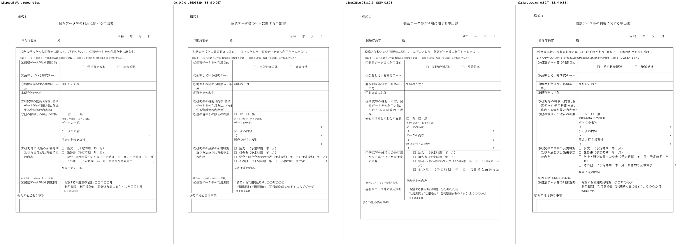

# Oxidocs benchmarks

How close Oxidocs comes to Microsoft Office, measured on frozen sets of real documents that were never used to tune the engine. The [README](../README.md#layout-accuracy-vs-microsoft-word) has the summary; this page has the full tables, the corpus rules, the limits and how to reproduce every number.

## How the corpora are split

An accuracy number is only as honest as the corpus it comes from. Oxidocs' documents are split into three roles, per language, and only one of them is allowed to be a headline:

| Role | What it is | May be a fix target? |
|------|------------|----------------------|
| **dev** | The tuned corpus: 96 documents under per-paragraph pagination gates + a 369-document (1113-page) pixel-SSIM sentinel + synthetic probes, plus every blind set retired by rotation | Yes — this is where bugs are root-caused |
| **validation** | Previously blind sets, demoted after rotation | Yes, after demotion |
| **blind** | 50 documents per language, **frozen before measurement, never anatomized**; re-measured per binary revision, not tuned against | **No** |

The blind sets are drawn from the public [superdoc-dev/docx-corpus](https://docxcorp.us/) (ODC-BY, 736K real .docx from Common Crawl) by a deterministic rule declared *before* fetching: 10 document types × the next 5 documents in SHA-256-ascending manifest order, with a purely mechanical quarantine (valid zip, has `word/document.xml`, no macros, ≤ 4 MB). No quality-based selection, no post-hoc swaps. When a newer blind set is frozen, the old one is demoted to validation and only then becomes fixable.

Everything below is measured against **Microsoft Word's own render** of the same file (Microsoft 365 16.0.20527.20088, 150 DPI, resize-to-match, structural similarity; one fresh Word process per document). Nobody grades their own homework.

One measurement note, because it would otherwise flatter a competitor: **OfficeCLI is measured with `--render html`, its own layout engine.** Its default `--render auto` is documented as "native on Windows w/ Word", and on a host with Word installed that path hands the rendering to Word itself — 0.996 SSIM against Word, because it *is* Word. Its own engine scores 0.972 on that same page. Only the second is a comparison.

## Latest blind sets — blind-L50 and jaBlindL50 (2026-11-20)

Frozen 2026-11-20 (`pipeline_data/FROZEN_BLIND_L.md`) by the same rule as every set below — the next unclaimed SHA-256 ranks per type, declared before anything was fetched — and measured once on a clean build of commit `e39af0a4` (DWrite renderer, the `<w:lastRenderedPageBreak/>` hint ignored), declared in the freeze file before its first render. Word opened and exported all 100 documents; Oxidocs rendered all 100. The same three English manifest entries as blind-J/K failed the mechanical quarantine at the draw, and the Japanese `technical` type is still exhausted, so its five slots went to `forms` by the top-up rule.

| Set | Engine | mean SSIM (common pages) | penalized | page count matches Word | documents scored |
|-----|--------|--------------------------|-----------|-------------------------|------------------|
| English (blind-L50) | **Oxidocs `e39af0a4`** | **0.926** | **0.920** | **49 / 50** | 50 |
| | LibreOffice 26.8.2.2 | 0.862 | 0.851 | 43 / 50 | 50 |
| Japanese (jaBlindL50) | **Oxidocs `e39af0a4`** | **0.884** | **0.862** | **43 / 50** | 50 |
| | LibreOffice 26.8.2.2 | 0.794 | 0.754 | 40 / 50 | 50 |

Per document (common-page SSIM), Oxidocs is ahead of LibreOffice on 39 of the 50 English documents and 44 of the 50 Japanese ones. Only LibreOffice was re-run beside Oxidocs this time; the full field of engines was last measured on blind-J, below. These are different documents from blind-J, so the two rotations are not comparable number for number.

## English blind set — blind-J50, 50 never-seen documents

Frozen 2026-11-03 (`pipeline_data/FROZEN_BLIND_J.md`) as the next unclaimed SHA-256 ranks per type, **before** any measurement. Every engine renders the same 50 documents; where one produced nothing for a document, its row says how many it managed. Three English manifest entries failed the mechanical quarantine at the draw and the next ranks took their slots; Word opened and exported all 100 documents of the two sets.

**Why a new set.** Blind-I (2026-10-25) became a fix target on 2026-10-30, so it can no longer say how the engine generalizes. The sets are different documents and are not comparable: Oxidocs scored 0.903 on I50 and 0.924 here.

**Every engine is at its latest public release on the measurement day** (2026-11-03): LibreOffice 26.8.2.2, the npm-distributed engines at `@latest`, GenOffice pulled to its newest commit, ibisOffice and WordCraft from their newest release archives (checksums verified), OfficeCLI 1.0.160; ONLYOFFICE 10.0.0 and eigenpal 1.9.0 were already current.

| Engine | mean SSIM (common pages) | penalized | page count matches Word | documents scored |
|--------|--------------------------|-----------|-------------------------|------------------|
| **Oxidocs 0.9.0** | **0.924** | **0.911** | **46 / 50** | 50 |
| ONLYOFFICE 10.0.0 | 0.921 | 0.901 | 43 / 50 | 50 |
| LibreOffice 26.8.2.2 | 0.889 | 0.868 | 44 / 50 | 50 |
| WordCraft 0.15.0 | 0.886 | 0.854 | 40 / 50 | 50 |
| SILURUS @silurus/ooxml 0.89.7 | 0.863 | 0.830 | 40 / 50 | 50 |
| GenOffice e1f50e90 | 0.847 | 0.818 | 41 / 50 | 50 |
| Polaris Office 11.115.233 | 0.823 | 0.771 | 34 / 50 | 50 |
| ibisOffice 0.8.5 | 0.801 | 0.766 | 36 / 50 | 50 |
| BetterOffice @betteroffice/docx 0.5.1 | 0.774 | 0.654 | 30 / 50 | 50 |
| eigenpal @eigenpal/docx-editor-react 1.9.0 | 0.759 | 0.698 | 34 / 50 | 50 |
| OfficeCLI 1.0.160 (`--render html`) | 0.753 | 0.483 | 23 / 50 | 50 |

**Oxidocs is first in English, 0.003 ahead of ONLYOFFICE — inside the ±0.02 one sample carries — and places page breaks best (46 / 50).** Document by document the race is closer than the mean: ONLYOFFICE is nearer to Word on 30 of 50 documents and Oxidocs on 20; WordCraft wins 23 against Oxidocs' 27, LibreOffice 16 against 34. The worst Oxidocs document is at 0.352 — a one-page document Oxidocs spreads onto two, a defect, since LibreOffice scores it 0.813.

## Japanese blind set — jaBlindJ50, 50 never-seen documents

Frozen 2026-11-03 by the same rule, **before** any measurement. The Japanese `technical` type is still exhausted in the public manifest, so its five slots were filled by the pre-declared top-up rule (all five from `forms`).

| Engine | mean SSIM (common pages) | penalized | page count matches Word | documents scored |
|--------|--------------------------|-----------|-------------------------|------------------|
| **Oxidocs 0.9.0** | **0.892** | **0.866** | **45 / 50** | 50 |
| ibisOffice 0.8.5 | 0.825 | 0.789 | 43 / 50 | 50 |
| Polaris Office 11.115.233 | 0.812 | 0.732 | 33 / 50 | 50 |
| LibreOffice 26.8.2.2 | 0.807 | 0.789 | 42 / 50 | 50 |
| SILURUS @silurus/ooxml 0.89.7 | 0.805 | 0.734 | 34 / 50 | 50 |
| GenOffice e1f50e90 | 0.801 | 0.717 | 32 / 50 | 49 |
| WordCraft 0.15.0 | 0.789 | 0.753 | 39 / 50 | 50 |
| ONLYOFFICE 10.0.0 | 0.770 | 0.747 | 42 / 50 | 50 |
| BetterOffice @betteroffice/docx 0.5.1 | 0.756 | 0.679 | 35 / 50 | 50 |
| OfficeCLI 1.0.160 (`--render html`) | 0.745 | 0.544 | 28 / 50 | 50 |
| eigenpal @eigenpal/docx-editor-react 1.9.0 | 0.744 | 0.701 | 37 / 50 | 50 |

**Oxidocs is first in Japanese by 0.067 over ibisOffice and 0.085 over LibreOffice**, closer to Word than ibisOffice on 39 of 50 documents, than LibreOffice on 40, than ONLYOFFICE on 42 and than Polaris Office on 43. Its weak point is page breaks: the three worst Japanese documents (0.32–0.46) are one-page documents Oxidocs spreads onto two, and ten of the fifty score below 0.80 penalized.

**Rankings do not transfer between languages.** ONLYOFFICE is second in English and eighth in Japanese; ibisOffice is eighth in English and second in Japanese. That is the whole reason for keeping a blind set per language, and for keeping both numbers on this page rather than the flattering one.

Every engine was measured against the same Word ground truth (Microsoft 365 16.0.20527.20088, 150 DPI). Versions are recorded in `_engine_versions_blindJ50.json` beside each result. Measurement notes, each written down before any number was compared: (1) GenOffice's window timed out on one Japanese document (`reference__704212ae`), counted as not rendered. (2) OfficeCLI's low page-count match is its own pagination: the harness takes the page count from OfficeCLI's own view and captures every page it reports. (3) Polaris Office has no command line, so its export is driven through its own window; it had updated itself to 11.115.233 before the run and was measured at that version. (4) Oxidocs was measured from a clean build of commit `58eb49d1`, declared in the freeze file before its first render.

## Chinese (Simplified) blind set — zhBlindA50, 50 never-seen documents

Frozen 2026-11-09 (`pipeline_data/FROZEN_BLIND_ZH_A.md`) **before** any fetch or measurement, by the same rule on the `lang=zh` manifest: 10 types × the next 5 Simplified-Chinese documents in SHA-256-ascending order that nothing had touched. Script is decided mechanically (ideographs encodable in GB2312 but not Big5 vs the reverse); 26 Traditional-Chinese and 2 over-size documents were skipped on the way, no top-up was needed. This is the first Chinese set: the 50-document Chinese development pool drawn the same day had already been used to find and fix two defects, so it is not quoted here.

Documents keep the fonts they ask for. The measurement PC carries the Windows Chinese supplemental fonts; documents naming commercial faces it lacks (方正 / 华文, common in government documents) stay in, and Word's own substitution is the truth. Word exported every document twice and the second export is the truth — an Office cloud font downloading during the first export leaves a substitute face in that PDF.

| Engine | mean SSIM (common pages) | penalized | page count matches Word | documents scored |
|--------|--------------------------|-----------|-------------------------|------------------|
| **Oxidocs (commit `c513bd40`)** | **0.874** | **0.869** | **48 / 50** | 50 |
| WPS Office 中国版 12.1.0.29161 | 0.836 | 0.804 | 44 / 50 | 50 |
| LibreOffice 26.8.2.2 | 0.789 | 0.725 | 36 / 50 | 50 |

**Oxidocs is first in Chinese, 0.038 ahead of WPS Office** — the Office suite most Chinese users open .docx files in — and places page breaks best (48 / 50). Document by document WPS is the stronger opponent than its mean suggests: Oxidocs is nearer to Word on 31 of the 50 documents and WPS on 18; against LibreOffice Oxidocs is nearer on 47. The worst Oxidocs document is at 0.436, a document Oxidocs fits onto one page fewer than Word.

Measured against the same Word ground truth as the other sets (Microsoft 365 16.0.20527, 150 DPI). WPS Office was driven through its own COM automation (`Kwps.Application`, `ExportAsFixedFormat`), LibreOffice with `soffice --convert-to pdf`. Oxidocs was measured from a clean build of commit `c513bd40`, whose hash was written into the freeze file before its first render. The other engines in the English and Japanese tables were not run on this set.

## How much does one blind set decide?

Three independently frozen Japanese blind sets, each measured once against the binary of its day:

| Japanese blind set | Oxidocs mean SSIM | page count matches Word |
|--------------------|---------------|-------------------------|
| blind-B50 (ranks 11-15, 2026-08-31) | 0.842 | 45 / 50 |
| blind-C50 (ranks 16-20, 2026-08-31) | 0.802 | 35 / 50 |
| blind-D50 (ranks 21-25, 2026-09-11) | 0.802 | 40 / 50 |
| blind-H50 (next unclaimed ranks, 2026-10-02) | 0.857 | 41 / 50 |
| blind-I50 (next unclaimed ranks, 2026-10-25) | 0.905 | 47 / 50 |
| blind-J50 (next unclaimed ranks, 2026-11-03) | 0.892 | 45 / 50 |
| blind-L50 (next unclaimed ranks, 2026-11-20) | 0.884 | 43 / 50 |

B50 and C50 were measured the same day on the same binary, so the 0.040 between them is set difficulty and nothing else. Roughly a quarter of that is a known defect — 19 of the 50 blind-C documents contain an anchored floating text box whose text Oxidocs drops, and those documents average 0.06-0.10 lower than the rest — and the remainder is simply that one sample of fifty wild documents is harder than another. **A single blind number carries about ±0.02, and a page-count rate can move 90% → 70% between samples.**

D50, cut eleven days and one engine revision later, landed on 0.802 again. Two independent samples agreeing to four decimal places is the strongest evidence on this page that the Japanese number is a property of the engine rather than of the corpus.

H50, three weeks and one engine generation later, is the first Japanese set to leave 0.80: 0.857. Two rotations (E, F, G) of pagination-only blind measurement were tuned against in between, so that step is engine, not sampling — but it is one sample, and the ±0.02 above still applies to it.

I50, three weeks and 219 commits later (145 of them layout fixes derived from Word measurements), is the first to pass 0.90: 0.905, with page breaks matching Word on 47 of 50. Again one sample, and the ±0.02 above applies.

J50, nine days and 126 commits later, came in lower: 0.892, 45 of 50. Nothing was tuned against it, so that is the ±0.02 at work — and a reminder that the Japanese number has not yet settled above 0.90.

L50, seventeen days and 872 commits later, reads 0.884 with 43 of 50 page counts matching — inside the ±0.02 band again, and still below 0.90. The English set rose to 0.926 with 49 of 50 page counts matching.

The English sets moved too — 0.903 on C50, 0.837 on D50, 0.874 on H50, 0.903 on I50, 0.924 on J50, 0.926 on L50 — but C50 had been rotated into the development corpus by then, so set difficulty and tuning cannot be separated there and the C50 English number is retired rather than quoted.

Two honest caveats about the two engine tables together: (1) the English and Japanese sets are different documents, so the numbers are not comparable across languages — each is only comparable *within* its table; (2) engine rankings do not transfer between corpora (ONLYOFFICE leads English and comes ninth in Japanese), which is exactly why blind sets per language exist.



*What the differences look like: the same Japanese government research-application form (rotated table-cell labels), rendered by Word, Oxidocs, LibreOffice and @silurus/ooxml. This document is from the **development** corpus and is shown for illustration only — the numbers above come from the blind sets.*

## PowerPoint (PPTX) blind set — 50 HuggingFace documents

The same measurement discipline, applied to real-world `.pptx` files. 50 files are sampled at random (seed `20260809`) from [noxneural/pptx_collection_templates](https://huggingface.co/datasets/noxneural/pptx_collection_templates) before any measurement, and each is scored against **Microsoft PowerPoint's own render** (Microsoft 365 16.0.20131.20154, 150 DPI, resize-to-match, structural similarity — the same pipeline as the Word tables above).

| Engine | mean SSIM vs PowerPoint (per doc) | page count matches PowerPoint |
|--------|----------------------------------|------------------------------|
| **Oxidocs** (2026-08-20, re-measured) | **0.953** | **48 / 48** |
| LibreOffice 26.2.1.2 | 0.913 | 48 / 48 |
| ONLYOFFICE 9.3.1.8 | 0.908 | 48 / 48 |

Two of the 50 sampled files (corrupt zip containers, unopenable by every engine — PowerPoint COM, LibreOffice, ONLYOFFICE's x2t and Oxidocs all reject them) are excluded, leaving **48** measured documents — every engine matches PowerPoint's slide count on all 48. **Oxidocs now leads both suites on this frozen set** (paired difference vs LibreOffice +0.040 ± 0.005, |t| = 8.7, ahead on 44 of the 48 documents; LibreOffice and ONLYOFFICE remain statistically tied with each other). The set was first measured at **0.679** (2026-08-13, the renderer's first PPTX measurement) — the week of renderer work since (slide-master placeholder inheritance, group transforms under mirroring, embedded fonts, color emoji, mixed-face line boxes) moved it to 0.953, with **every one of the 48 documents improving and none regressing**; the worst document now scores 0.880. As with the Word tables, the set is frozen, never anatomized, and re-measured as the engine improves. One operational note: ONLYOFFICE's x2t emits unusually large intermediate PDFs (up to 65 MB for a single deck), which dominates its pipeline cost. Per-document scores, the paired statistics and the full method: [docs/benchmarks/pptx-hf50.md](benchmarks/pptx-hf50.md); raw scores as JSON: [docs/benchmarks/pptx-hf50-results.json](benchmarks/pptx-hf50-results.json).

## The internal gates (development corpus)

The blind sets are the published claim; the development corpus is how regressions are caught before a change is committed. Every layout change must pass, in order:

- **Pagination oracle** — per-paragraph page match against real Word (COM-measured) on the 96-document development corpus (90 Japanese + 6 English government documents): currently **96/96 = 100%**.
- **SSIM regression sentinel** — 369 documents (1113 pages) pixel-compared against stored Word renders; a change that improves one document by regressing another has to justify the trade.
- **Adversarial probe harness** — 95 synthetic documents stressing under-tested layout paths, each gated against real Word ground truth.
- **Feature-injection perturbation harness** — individual OOXML features injected one at a time into a clean base document and pixel-verified against Word.
- **PPTX render gate** — 40 development decks (886 slides) pixel-compared against PowerPoint's own PDF render (mean SSIM 0.957), plus 156 synthetic probe decks byte-compared per change and a determinism check (same input twice → identical bytes). LibreOffice Impress and a browser OOXML viewer render the same decks as independent references, so a slide where they land closer to PowerPoint than Oxidocs does is a bug with a worked example.
- **Spreadsheet oracles** — the formula engine recalculates 285 real .xlsx workbooks and diffs against Excel's own cached results; the browser VBA host is checked against real Excel COM behavior.
- **Unit / integration suite** — `cargo test`.

These numbers are *tuned* — every document in them has been individually root-caused — so they belong in a gate, not in a headline. The date-by-date development history is in [docs/layout_accuracy.md](layout_accuracy.md).

## Word's saved page breaks — a hint the benchmark must not see

When Word saves a .docx it writes `<w:lastRenderedPageBreak/>` wherever its own render started a new page. That marker is part of the answer every number on this page is scored against, and **Oxidocs' parser reads it by default**: several layout rules use it as a hint. The blind-set numbers above were measured that way. Whether the other engines in the tables read the marker has not been checked, so the page-count column may favour Oxidocs.

From now on the benchmarks run **blind**: `OXI_IGNORE_LRPB=1` makes the parser drop the marker, so no layout rule can see it, and `tools/metrics/bench_env.py` sets it for benchmark scripts unless `OXI_BENCH_WITH_LRPB=1` asks for the hinted mode. **Re-measured blind (2026-10-28).** The published blind-I numbers were re-run with the frozen engine (77605bde) on copies of the same 100 documents with every `<w:lastRenderedPageBreak/>` removed, against the same Word PDFs:

| | with the marker (published) | blind |
|---|---|---|
| EN mean SSIM / penalized / page count | 0.9028 / 0.8829 / 47 of 50 | 0.9031 / 0.8831 / 47 of 50 |
| JA mean SSIM / penalized / page count | 0.9050 / 0.8985 / 47 of 50 | 0.9050 / 0.8985 / 47 of 50 |

The tables above stand: the marker did not contribute to them. The current engine also scores identically in both modes on blind-I. Benchmarks keep running blind by default regardless.

The same marker also makes a **Word-free pagination check** that anyone can run on their own files. `tools/oxi-lrpb-bench` derives the page every paragraph and table row starts on from the markers, checks that derivation against the page count Word wrote in `docProps/app.xml`, then scores Oxidocs blind and hinted:

```bash
cd tools/oxi-lrpb-bench && cargo build --release
./target/release/oxi-lrpb-bench <file.docx | folder>... [--json out.json]
```

First run, on the Word-saved files of [docling](https://github.com/docling-project/docling)'s public `tests/data/docx` (2026-10-28; English only, so a smoke test rather than a claim):

| | blind | hinted |
|---|---|---|
| paragraphs and table rows on Word's page | 286 / 304 | 286 / 304 |
| page count matches Word | 8 / 10 | 8 / 10 |
| Word's page breaks placed at the same spot | 16 / 17 | |

The derived page counts matched `docProps/app.xml` on all 10 files. The marker cannot replace Oxidocs: it gives a page number but no position on the page, files saved by anything other than Word do not carry it, and it goes stale as soon as the document is edited.

## Reproduce

```bash
tools/metrics/fetch_docx_corpus.py      # fetch the public corpus (deterministic, SHA-ordered)
tools/metrics/ssim_now.py               # Oxi absolute SSIM re-measure vs stored Word renders
tools/metrics/ssim_ab.py <VAR>          # A/B a single rule against the whole corpus
tools/metrics/render_libra.py           # LibreOffice headless → PDF → PNG
tools/metrics/render_onlyoffice.py      # ONLYOFFICE x2t headless → PDF → PNG
tools/metrics/browser_oracle.py         # @silurus/ooxml via Playwright (tools/browser-oracle/)
tools/metrics/compare_renderers_3way.py # cross-renderer scoring on identical inputs
tools/oxi-lrpb-bench                    # Word-free page-break check against Word's saved markers
```

---

## How the fidelity is earned

### 100% Clean-Room Implementation

Oxidocs' rendering engine was built without any disassembly, decompilation, or binary analysis of proprietary software. All layout specifications come from two sources only:

1. **Published standards** — OOXML (ISO/IEC 29500 / ECMA-376), PDF (ISO 32000)
2. **Black-box testing** — observing output values via the Microsoft Office COM API, and measuring Word's own PDF/PNG renders

AI (Claude) was used throughout specification derivation — root-cause analysis, COM measurement, pattern confirmation, fix implementation — with every specification decision grounded in measured values and confirmed by human review. Under Microsoft's [Open Specification Promise](https://learn.microsoft.com/en-us/openspecs/dev_center/ms-devcentlp/1c24c7c8-28b0-4ce1-a47d-95fe1ff504bc), no patents are asserted against implementations of the OOXML specification.

### Dual Font Engine: GDI + DirectWrite

Word's layout is built on GDI, which rounds character widths to integer pixels and computes line heights by rounding ascent and descent separately before adding them. These roundings cascade: a 0.18pt/character difference at Calibri 11pt becomes 10.8pt of accumulated error over 60 characters — enough to change where lines break and pages split. Reproducing Word therefore requires reproducing GDI exactly; for formats without a GDI heritage, it requires *not* inheriting those constraints.

| Format | Engine | Reason |
|--------|--------|--------|
| .docx (Word compatible) | **GDI** | Word uses GDI text metrics — integer-pixel rounding, tmHeight line heights, hinting-dependent widths |
| .odt / .pdf | **DirectWrite** | ODF has no single canonical engine; DirectWrite's floating-point metrics give cross-platform consistency, variable-font and modern OpenType support, without GDI's legacy rounding |

Both engines implement a shared `FontEngine` trait, so the layout engine switches with a one-line configuration change per document.

### Open Fonts Only

Oxidocs bundles no proprietary fonts. Open-licensed fonts are metric-matched to their Microsoft counterparts (advance width, line height, kerning — verified by automated tests). For documents authored with Microsoft Fonts, a **font divergence score** — a per-glyph pixel-diff table generated once on a licensed system, combined with the document's character frequency — quantifies visual fidelity without shipping proprietary fonts at runtime.

### Golden Tests — 504 Files, 100% Parse Success

Tested against 504 real-world government documents (Japanese ministries) + generated files:

|        | Oxidocs    | LibreOffice |
|--------|--------|-------------|
| Overall | 100.0% | 99.2% |
| DOCX   | 100.0% | 100.0% |
| XLSX   | 100.0% | 98.6% |
| PPTX   | 100.0% | 100.0% |

LibreOffice timed out (>45s) on 4 large government xlsx files. Oxidocs parsed all instantly.
