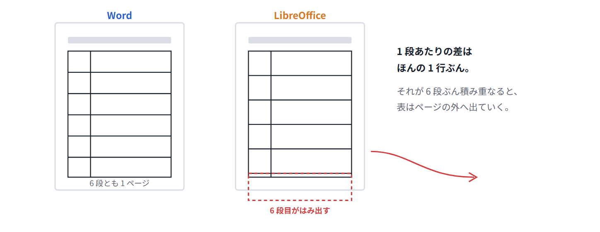
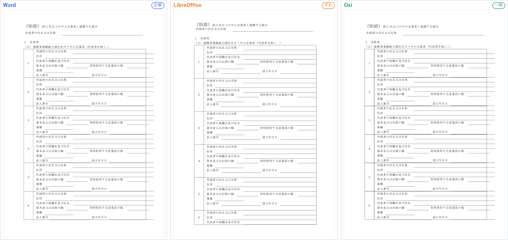
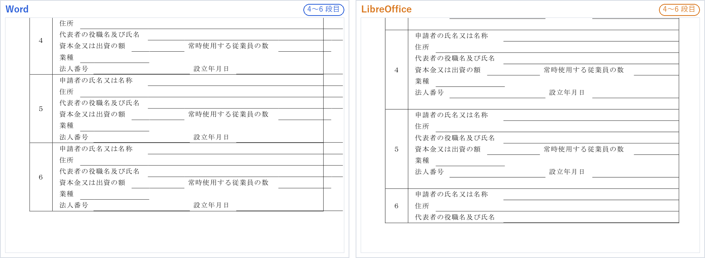
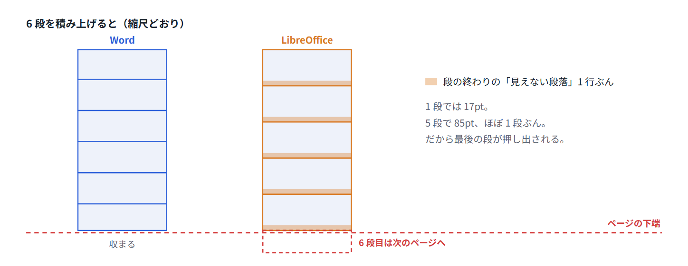
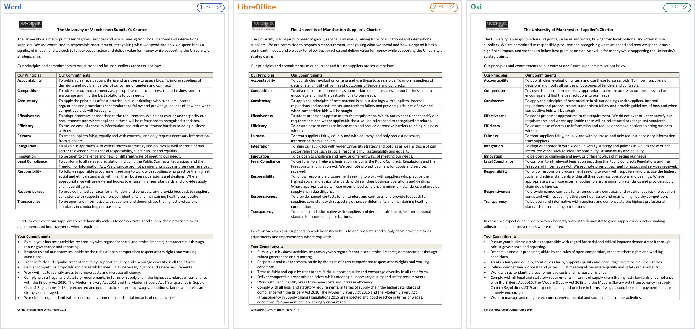
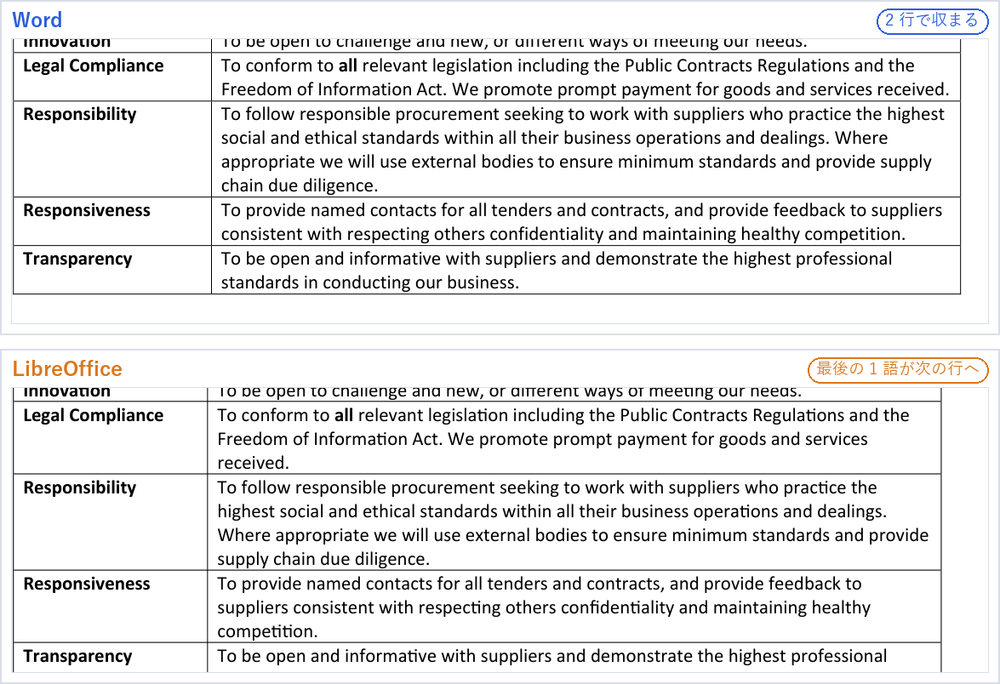
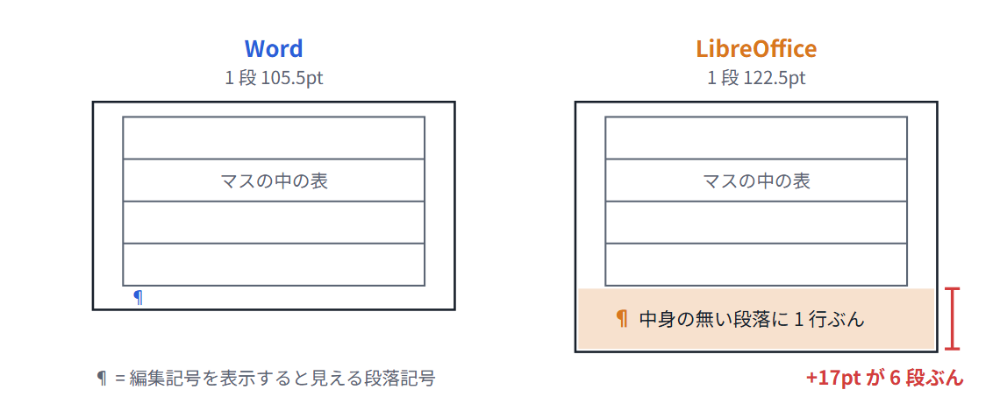
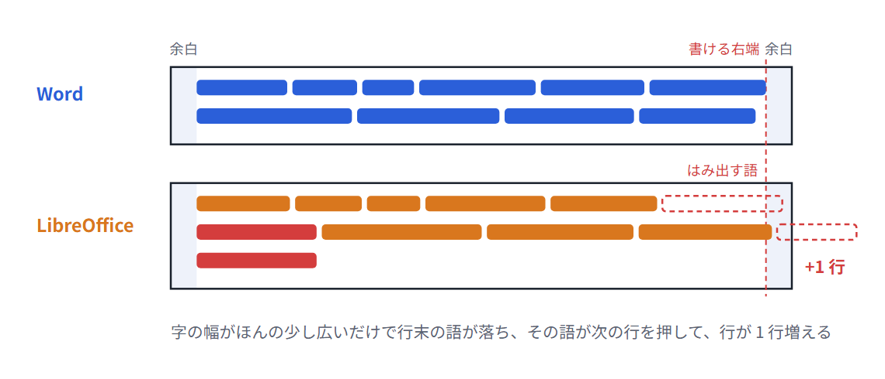
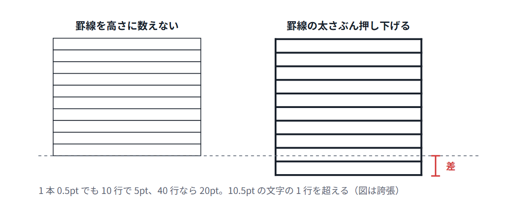
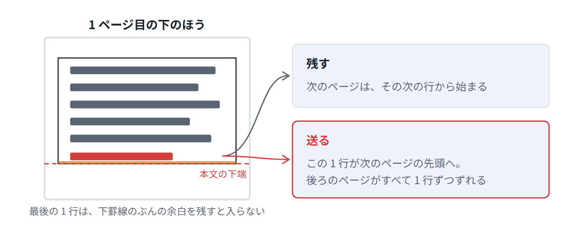

# 「Word 互換」なのに、なぜ表はずれるのか

Word で作った書類を LibreOffice や別のアプリで開いたら、表が微妙に下へずれて、最後の行が次のページに押し出されていた。たぶん一度は見たことのある光景です。

私たちは Word の文書を Word と同じ見た目で描くエンジン **Oxi** を作っていて、毎日 Word の出力と 1pt 単位で突き合わせています。その立場から、実際の書類を使って「どこで、なぜ」ずれるのかを見ていきます。

## まず結論から

ずれの原因はたいてい「どちらかのバグ」ではありません。Word の表には、仕様書（OOXML）を読んでもはっきり書かれていない**小さな癖**がいくつもあります。互換アプリはそれを推測で埋めるので、1 か所あたり数ポイントの違いが生まれます。

表はその小さな違いを**積み重ねる**形をしています。行が 10 行あれば 10 回、段が 6 段あれば 6 回、同じ違いが足し算されます。だから本文ではほとんど気にならない差が、表だと目に見える崩れになります。

実際の書類で 2 つ見てみます。

## 例 1：申請書の様式（6 段の入れ子の表）

よくある役所の様式です。1 社ぶんの記入欄が 6 行の小さな表になっていて、それが大きな表の 1 段に入り、6 社ぶん並んでいます。

*同じ .docx を 3 つのアプリで PDF にしたもの。LibreOffice だけ、6 段目の途中でページが終わっています。*

1 段の高さを PDF から測ると、違いははっきりしています。

| | 1 段の高さ |
|---|---|
| Word | 105.5pt |
| LibreOffice | 122.5pt |
| 差 | **+17pt**（≒ 1 行） |

1 段あたり 17pt。この文書の 1 行の高さとほぼ同じです。拡大すると、LibreOffice では各段の最後に**空いた行が 1 行**ぶん入っているのが分かります。

> **この 1 行はどこから来たの？**
>
> Word のルールでは、表のマス（セル）は必ず「段落」で終わらなければなりません。だから、マスの中に表を入れると、その直後に**中身の無い段落**が自動で 1 つ付きます。この見えない段落にどれだけの高さを与えるかで、アプリの答えが分かれます。この書類では、LibreOffice はそこに丸々 1 行ぶんの高さを取っていました。

## 例 2：大学の調達方針（1 ページの表）

今度は英語の書類です。左に項目、右に説明文が並ぶ、ごく普通の 2 列の表。Word では 1 ページにぴったり収まっています。

*LibreOffice では最後の 1 行が 2 ページ目に押し出され、ほぼ空のページが 1 枚増えます。*

表の中を拡大すると、原因は改行の位置でした。

*「received.」「competition.」の 1 語だけが入りきらず、3 行目に落ちています。それぞれの行が 1 行ずつ高くなりました。*

Word の行はもともと右端ぎりぎりまで詰まっていました。こういう「ぎりぎり収まっている行」は、字の幅やマスの内側の余白がほんの少し違うだけで、1 語はみ出します。1 語のはみ出しは 1 行のはみ出しになり、表全体を押し下げます。

## Word の表の、書かれていない癖

私たちが Word の出力を測ってきて分かった、表がずれやすいポイントです。どれも 1 か所では数ポイントの差ですが、表の中では行や段の数だけ繰り返されます。

:::details マスの最後の見えない段落
マスの中に表を入れると、直後に空の段落が必ず付きます。この高さの扱いが、例 1 のずれの正体でした。

- 例 1 の 1 段の高さは Word が 105.5pt、LibreOffice が 122.5pt。差の 17pt は、この書類の 1 行の高さとほぼ同じです。
- Word のマスは必ず段落で終わる決まりなので、この段落は消せません。
- 6 段あれば 6 回、同じ 17pt が足されます。

**自分で確かめるには**：Word の［ホーム］→［編集記号の表示/非表示］（¶ のボタン）を押すと、入れ子の表のすぐ下に ¶ が 1 つ見えます。これが見えない段落です。この段落の文字サイズを 1pt にして段落の前後の間隔を 0 にしておくと、ほかのアプリで開いたときのずれが小さくなります。
:::

:::details ぎりぎり収まっている行
行が右端ちょうどで終わっていると、字の幅やマスの余白の小さな違いで 1 語が次の行へ落ちます。例 2 のずれの正体です。

- 1 行に使える幅は「マスの幅 − 左右のマスの余白」です。Word の既定の余白は左右 0.19cm ずつ。
- 字の幅の足し方もアプリごとに少しずつ違います。Word は場面によって字の幅を画面の整数ピクセルに丸めてから並べるので、同じフォントでも 1 行の合計がずれます（詳しくは [Word の改ページ位置は、GDI の整数丸めで決まっている](https://oxi-dd65f4.gitlab.io/articles/word-pagination-gdi-rounding.ja.html)）。
- 例 2 では「received.」「competition.」の 2 語が落ち、2 か所で 1 行ずつ、合わせて 27pt 伸びました。

**防ぐには**：右端ぎりぎりまで詰まった行が多い表は、列の幅に少し余裕を持たせておくと、どのアプリでも同じ位置で折り返しやすくなります。
:::

:::details 罫線の太さを高さに数えるか
罫線の太さぶん、中身を押し下げるかどうか。1 行あたりは 1pt 未満でも、何十行もある表では数行ぶんになります。

- .docx の罫線の太さは 1/8pt 単位で保存されています。よく使う 0.5pt の線は「4」です。
- 0.5pt でも 40 行あれば 20pt。10.5pt の文字なら 1 行を超えます。
- 二重線は 2 本の線と間の空きを合わせた太さになるので、差はさらに大きくなります。
- どの罫線をどこまで高さに数えるかは、罫線の種類や表の設定で変わります。Oxi はこれを Word の出力を測って決めています。
:::

:::details ページをまたぐ行の切り方
ページの下に行の途中まで置くか、行ごと次のページへ送るか。1 行の判断が違うと、それより後ろのページがすべてずれます。

- Word の［表のプロパティ］→［行］→［行の途中で改ページする］がオフなら、その行はまるごと次のページへ送られます。
- オン（既定）なら行の途中で分けますが、ページの下端ぎりぎりの 1 行を残すか送るかは、下の罫線のために余白を残すかどうかで変わります。
- ［タイトル行の繰り返し］を使っている表は、2 ページ目以降の先頭にも見出しの行が入るので、その高さも計算に入ります。
:::

最後の点は特にやっかいです。最近見た 18 ページの英語の資料では、3 ページ目の下端で 1 行の扱いが違っただけで、その差が順送りに伝わり、17 ページ目の表が大きく崩れていました。崩れているのは 17 ページ目でも、原因は 14 ページも前にあります。

## なぜ LibreOffice は直さないのか

ここまで読むと「原因が分かっているなら直せばいいのに」と思うかもしれません。公開されているバグ管理の記録を見ると、事情は「直さない」より「直しきれない」に近いようです。

- **報告はたくさん届いている**：DOCX の段落まわりの互換不具合をまとめた親チケット（[107830](https://www.libreoffice.org/bugzilla/showdependencytree.cgi?id=107830)）1 つだけで、115 件の報告がぶら下がっています。例 1 と同じ「入れ子の表の後ろの空段落に余計な間隔が付く」現象は 2020 年に報告済みです（[134569](https://lists.freedesktop.org/archives/libreoffice-bugs/2020-July/295647.html)）。例 2 に近い「最小の高さの行が少しずつずれて積み上がる」報告もあります（[155229](https://www.libreoffice.org/bugzilla/show_bug.cgi?id=155229)）。
- **直すと別の文書が崩れる**：規則を Word に寄せると、その規則で正しく見えていた既存の文書が崩れます。そこで文書ごとに切り替える「互換フラグ」を足すのですが、開発者の議論には「いったん追加したレイアウト用フラグの挙動を後から変えるのは好ましくない」という趣旨の発言があります（[135943](https://lists.freedesktop.org/archives/libreoffice-bugs/2020-September/315952.html)）。一度入れると動かせないので、慎重になります。
- **正解が仕様書に無い**：Word が実際にどう組むかは仕様書に書かれていないので、直すときも推測になります。直した結果、Word とは別のずれ方になった例も記録に残っています。
- **癖は 1 つずつしか潰せない**：表のずれは 1 つの大きなバグではなく、小さな癖の集まりです。どれか 1 つを直しても、別の癖で同じ書類がまだずれる。報告の数だけ地道な作業が要ります。

つまり足りないのは意欲ではなく、「Word はこの場合こう組む」という**正解を、文書を崩さずに確かめる手段**です。

## じゃあ、どうやって合わせるのか

Oxi ではこういう癖を、推測ではなく Word そのものに聞いて決めています。小さな試験用の文書を何十通りも作り、Word に描かせて、どこで結果が変わるかを測ります。上の 2 つの例で Oxi が Word と同じ見た目になっているのは、そうして一つずつ癖を写してきた結果です。

とはいえ、まだ全部ではありません。Word と見分けがつかないところまで来た文書もあれば、今もページの途中で 1 行ずれる文書もあります。表が崩れる書類を見かけたら、それは癖の見本です。ぜひ教えてください。

---

**計測について**：同じ .docx を Microsoft Word（Windows）、LibreOffice、Oxi でそれぞれ PDF に書き出し、ページ上の文字の位置を比べました。数値は PDF から読み取った実測値です。LibreOffice の内部でどう計算しているかは推測を含みます。この記事で言い切っているのは「出力がこう違う」ことまでです。「なぜ直さないのか」の節は、LibreOffice の公開バグ管理（Bugzilla）とその通知メールの記録から読み取った内容です。
