# Why tables shift in “Word-compatible” office suites

You make a document in Word, open it in LibreOffice or another office suite, and the table has crept down the page. Its last row now sits on the next page. Most people have seen this at least once.

We build **Oxi**, an engine that draws Word documents the way Word draws them, and we compare its output with Word's to the point every day. This post uses two real documents to show where the shift comes from, and why.

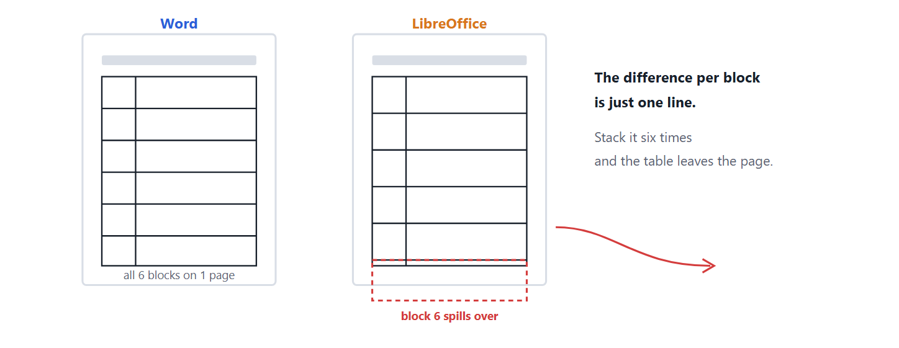

## The short answer

The shift is usually not a bug in one program or the other. Word's tables have a number of **small habits** that the file format specification (OOXML) does not spell out. Compatible suites fill those gaps with guesses, and each guess can be off by a few points.

A table is a machine for **adding up** small differences. Ten rows repeat the same difference ten times; six blocks repeat it six times. A gap you would never notice in body text becomes a visible break inside a table.

Here are two real documents.

## Example 1: a Japanese application form (six nested blocks)

This is a typical government form. Each company's entry is a small six-row table, placed inside one block of a larger table, and the form holds six companies.

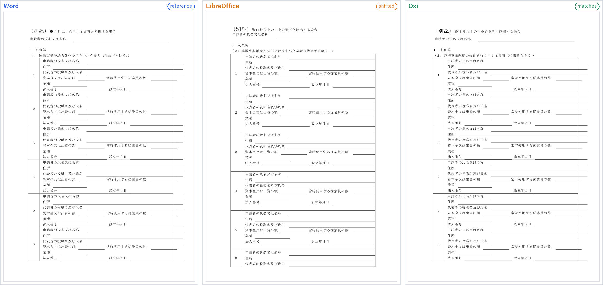
*The same .docx exported to PDF by three programs. Only LibreOffice runs out of page partway through block 6.*

Measured from the PDFs, the difference is clear.

| | Height of one block |
|---|---|
| Word | 105.5pt |
| LibreOffice | 122.5pt |
| Difference | **+17pt** (about one line) |

17pt per block is almost exactly one line of this document. Zoom in and you can see that LibreOffice leaves **one empty line** at the bottom of every block.

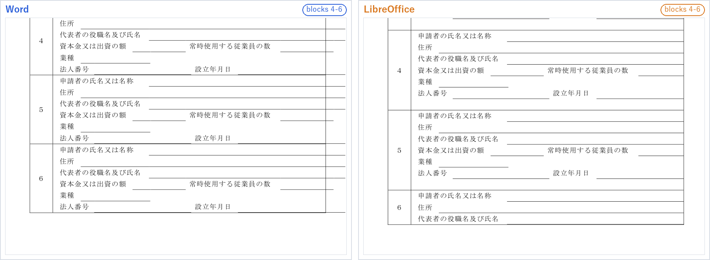

> **Where does that line come from?**
>
> In Word, every table cell must end with a paragraph. So when you put a table inside a cell, Word adds an **empty paragraph** right after it. Programs disagree on how tall that invisible paragraph is. In this document LibreOffice gives it a full line.

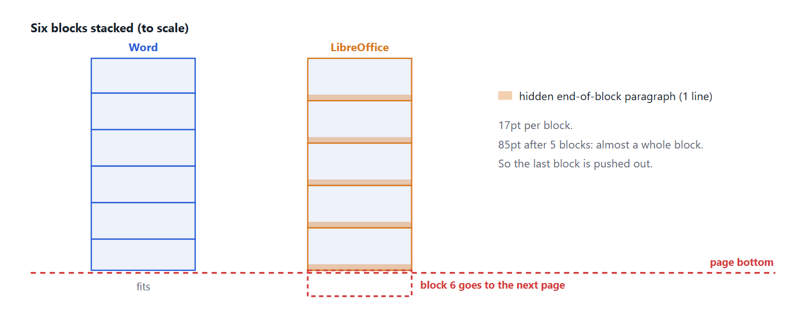

## Example 2: a university procurement policy (a one-page table)

This one is in English: an ordinary two-column table, with a topic on the left and a description on the right. In Word it fits on exactly one page.

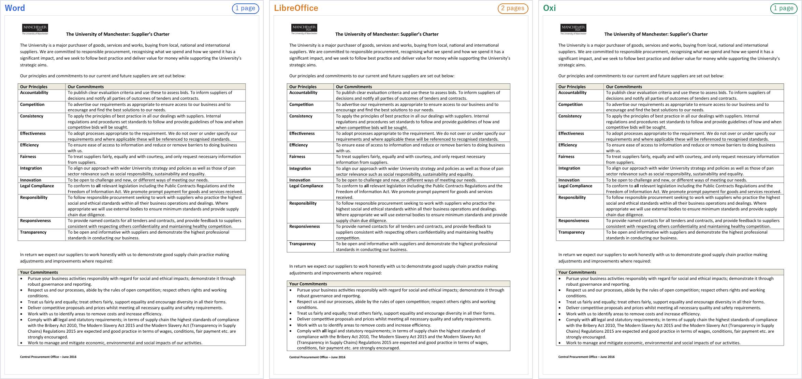
*In LibreOffice the last line moves to page 2, which adds an almost empty page.*

Zooming into the table shows that the cause is where lines break.

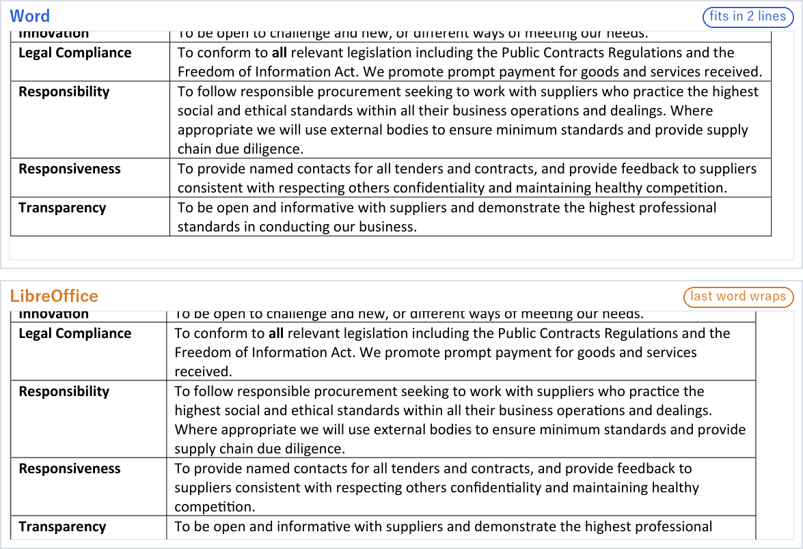
*The single words "received." and "competition." no longer fit and drop to a third line, so each of those rows grows by one line.*

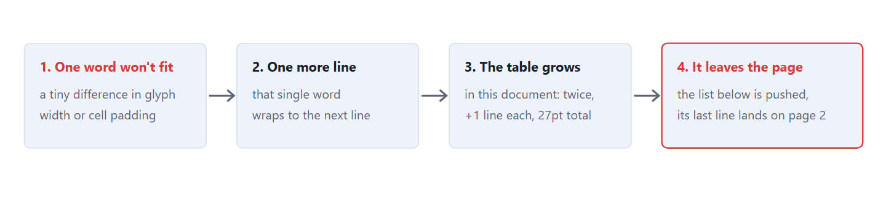

In Word those lines already ran right up to the cell's edge. A line that only just fits loses its last word when a glyph is a hair wider or the cell padding is a hair larger. One word becomes one extra line, and the whole table moves down.

## Word's unwritten table habits

These are the places where we have measured tables shifting. Each is worth only a few points at a time, but a table repeats it once per row or per block.

:::details The invisible paragraph at the end of a cell
A table inside a cell is always followed by an empty paragraph. How tall it is caused Example 1.

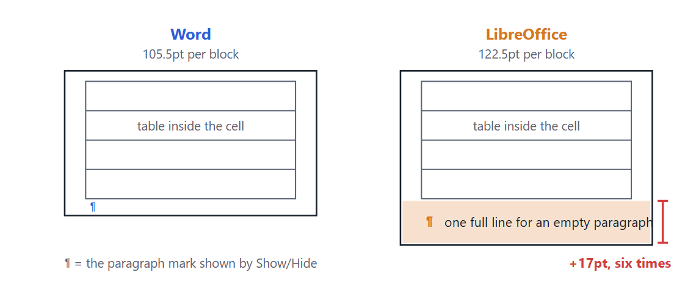

- In Example 1, one block is 105.5pt tall in Word and 122.5pt in LibreOffice. The 17pt difference is almost exactly one line of this document.
- A Word cell must end with a paragraph, so this one cannot be deleted.
- Six blocks add the same 17pt six times.

**Check it yourself:** In Word, click Home → Show/Hide (the ¶ button). A ¶ appears right below the nested table: that is the invisible paragraph. Setting its font size to 1pt and its spacing before and after to 0 makes the shift much smaller in other apps.
:::

:::details Lines that only just fit
When a line ends exactly at the right edge, a small difference in glyph width or cell padding pushes a word to the next line. That caused Example 2.

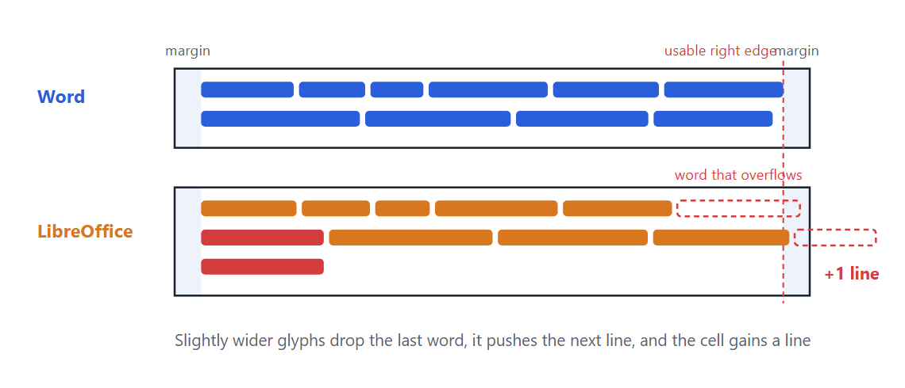

- The width a line can use is the cell width minus the left and right cell margins. Word's default is 0.08 inch on each side.
- Apps also add up glyph widths slightly differently. In some paths Word rounds each glyph width to whole screen pixels before placing it, so the same font can give a different line total (see [Why modern font metrics cannot reproduce Word pagination](https://oxi-dd65f4.gitlab.io/articles/word-pagination-gdi-rounding.html)).
- In Example 2 the words "received." and "competition." dropped, adding one line in two places: 27pt in total.

**To avoid it:** If a table has many lines packed right up to the edge, leave a little slack in the column widths. Every app will then tend to wrap in the same place.
:::

:::details Whether border width counts as height
Does a border push the cell's content down by its own thickness? It is under 1pt per row, but a table with dozens of rows loses several lines.

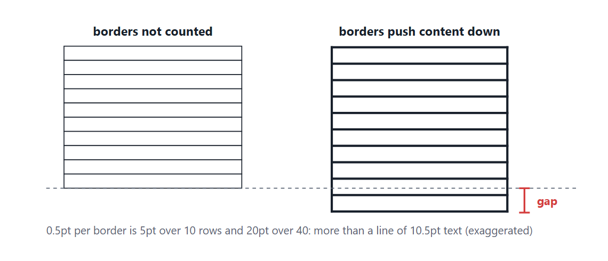

- A .docx stores border width in eighths of a point. The common 0.5pt line is stored as "4".
- 0.5pt over 40 rows is 20pt, more than one line of 10.5pt text.
- A double border is two lines plus the gap between them, so the difference grows.
- Which borders count toward height, and how much, depends on the border style and table settings. Oxi decides it by measuring Word's output.
:::

:::details How a row splits across pages
Does part of a row stay at the bottom of the page, or does the whole row move to the next one? Get one row wrong and every later page shifts.

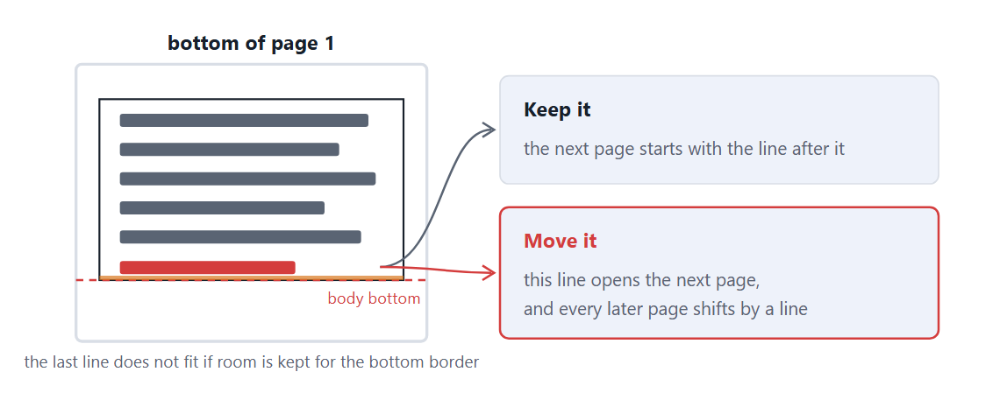

- If Table Properties → Row → "Allow row to break across pages" is off, the whole row moves to the next page.
- If it is on (the default), the row splits, but whether the last line that barely fits stays or moves depends on whether room is kept for the bottom border.
- A table with "Repeat as header row" adds its header to the top of every later page, and that height counts too.
:::

The last one is the hardest. In an 18-page English report we looked at recently, a single line handled differently at the bottom of page 3 carried forward page by page until the table on page 17 fell apart. The damage shows on page 17; the cause is 14 pages earlier.

## Why doesn't LibreOffice just fix it?

If the causes are known, why not fix them? From LibreOffice's public bug tracker, the answer looks less like "won't fix" and more like "can't fix them all."

- **The reports are there.** One meta bug that collects DOCX paragraph-compatibility issues ([107830](https://www.libreoffice.org/bugzilla/showdependencytree.cgi?id=107830)) has 115 reports under it. The behavior in Example 1, extra spacing on the empty paragraph after a nested table, was reported in 2020 ([134569](https://lists.freedesktop.org/archives/libreoffice-bugs/2020-July/295647.html)). There is also a report close to Example 2, where "at least" row heights drift a little and add up ([155229](https://www.libreoffice.org/bugzilla/show_bug.cgi?id=155229)).
- **A fix breaks other documents.** Changing a rule to match Word breaks existing documents that looked right under the old rule. The usual answer is a per-document compatibility flag, but one developer discussion notes that changing a layout flag's behavior after it has been added is undesirable ([135943](https://lists.freedesktop.org/archives/libreoffice-bugs/2020-September/315952.html)). Once a flag is in, it is hard to move, so new ones get added with care.
- **The right answer is not in the specification.** The spec does not say how Word actually lays things out, so a fix is also a guess. The tracker records fixes that ended up differing from Word in a new way.
- **Habits can only be fixed one at a time.** A shifted table is not one big bug but a pile of small habits. Fix one and the same document can still shift because of another. Each report is its own slow piece of work.

What is missing is not willingness. It is a way to **check what Word actually does, without breaking other documents.**

## So how do you match Word?

Oxi settles each habit by asking Word, not by guessing. We write small test documents in dozens of variations, have Word lay them out, and measure where the result changes. Oxi matches Word in the two examples above because each habit was copied over this way, one at a time.

It is not done yet. Some documents are now indistinguishable from Word; others still shift by a line partway down a page. If you find a document whose tables break, it is a specimen of one of these habits. Please send it our way.

---

**About the measurements:** We exported the same .docx to PDF from Microsoft Word (Windows), LibreOffice and Oxi, and compared where the text sits on each page. All numbers are measured from those PDFs. What LibreOffice computes internally is partly inferred; what this post states firmly is only how the outputs differ. The section on why LibreOffice does not fix these issues is based on its public bug tracker (Bugzilla) and the tracker's notification mail archive.
