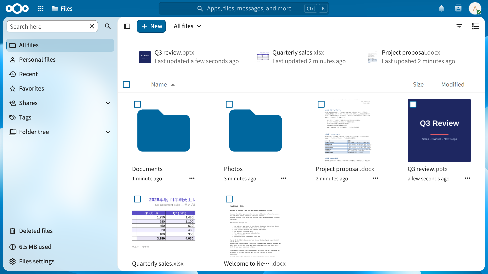

# Oxi Office Previews for Nextcloud

A Nextcloud app (`oxidocs_preview`) that shows thumbnails of Word, PowerPoint and Excel files in Files. It needs no LibreOffice, Collabora or ONLYOFFICE.



| Kind | Files | Thumbnail |
|---|---|---|
| Word | `.docx`, `.docm`, `.dotx`, `.dotm` | page 1 |
| PowerPoint | `.pptx`, `.pptm`, `.potx`, `.potm`, `.ppsx`, `.ppsm` | slide 1 |
| Excel | `.xlsx`, `.xlsm`, `.xltx`, `.xltm` | the first printed page, cut to the part with content |

Nextcloud ships its Office previews switched off: they start LibreOffice once for every file, and the admin manual calls them unsupported. This app draws the first page with the bundled [Oxi](https://github.com/Ryujiyasu/oxi) engine instead, a single Rust program that runs on the server:

- **Nothing to configure.** Enable the app and Office files get thumbnails. An app's preview provider is not subject to `enabledPreviewProviders`, so `config.php` stays as it is.
- **Fast.** About 0.1 s of drawing for a typical file. A long Word document takes longer, because the whole document is laid out before page 1 is drawn.
- **Local.** The file never leaves the server, and the app makes no network requests.
- **Self-contained.** Static builds for Linux x86_64 and arm64 are included, with their fonts. Alpine-based installs work too.

A thumbnail shows the first page as Oxi's PDF output would. On 100 documents scored against Microsoft Word's own PDFs, Oxi's layout came closer than LibreOffice's (see [integrations/gotenberg](../gotenberg#measured)), and on 48 PowerPoint decks scored against PowerPoint's own render it did too (see the [main README](../../README.md)).

An Excel sheet is printed onto A4 or Letter paper, so a small table would sit in a corner of a white page. The app asks for the printed page cut to the part with ink (`--trim`), kept to 2:1 at most, so the table fills the thumbnail.

## Install

From the App Store: **Apps → Files → Oxi Office Previews → Enable**.

By hand: unpack the release tarball into your `custom_apps` (or `apps`) directory, then run:

```bash
occ app:enable oxidocs_preview
```

Thumbnails are made the first time Files asks for them, as for other file types. To make them ahead of time, use the Preview Generator app.

## How it runs

- The app copies its build for the server's architecture into Nextcloud's temporary directory and runs it from there. It never writes into its own directory, which keeps a signed app's integrity check clean. On first use, the engine writes its bundled fonts next to that copy.
- Each thumbnail is one run of `oxidocs docx-to-png`, `pptx-to-png` or `xlsx-to-png --trim`, without a shell, and is stopped after 30 seconds.
- Nextcloud first asks for its largest preview (4096 px). The app draws that one at 2048 px at most, which is plenty for any thumbnail and much faster to handle.
- If the temporary directory is mounted `noexec`, or the server is neither x86_64 nor arm64, the app logs a warning and makes no previews. You can then point it at an `oxidocs` you built yourself (`cargo install oxidocs-cli`, or `pip install oxidocs`):

  ```bash
  occ config:app:set oxidocs_preview binary --value=/usr/local/bin/oxidocs
  ```

### Settings

All settings are optional, set with `occ config:app:set oxidocs_preview <key> --value=<value>`:

| key | default | meaning |
|---|---|---|
| `binary` | (bundled) | path of the `oxidocs` program to run |
| `timeout` | `30` | seconds before a thumbnail is abandoned |
| `max_size` | `52428800` | larger files get no thumbnail (bytes; `0` for no limit) |
| `max_pixels` | `2048` | upper bound on the drawn page's width and height |

## Checking it

`e2e/run.sh` starts the official Nextcloud image (version `NEXTCLOUD_VERSION`, default 35) with this app mounted read-only. It uploads two `.docx`, two `.pptx` and two `.xlsx` files and checks four things:

- Without the app, there is no preview.
- With the app, each preview is a drawn page.
- `oxidocs` ran from its temporary copy.
- The app logged nothing.

It needs `bin/oxidocs-linux-x86_64`, which the [workflow](../../.github/workflows/nextcloud-app.yml) builds. To build it locally:

```bash
docker run --rm -v "$PWD:/src" -w /src -e CARGO_TARGET_DIR=/src/target/musl rust:1-alpine \
  sh -c 'apk add musl-dev && cargo build --release -p oxidocs-cli --locked'
```

`package.sh` builds the App Store tarball from both builds.

## Notes

- This app is not part of Nextcloud. Report problems at [Ryujiyasu/oxi](https://github.com/Ryujiyasu/oxi/issues).
- This app was written with AI assistance (Claude).
- License: the app's own code is MIT OR Apache-2.0. The bundled `oxidocs` engine is MPL-2.0; its source is this repository.
